# Jornada Técnica — Conciliação Bancária

**Versão**: 1.1 · **Data**: 2026-10-04 · **Produto**: Agente de Bolso
**Para quem**: engenheiros que vão manter, integrar ou revisar o módulo `conciliacao` (backend, integradores de canal, SRE, segurança).
**Documentos irmãos**: [Fluxo de Caixa](JORNADA-TECNICA-FLUXO-DE-CAIXA.md) · [Plataforma e visão geral](JORNADA-TECNICA.md) (requisição, idempotência, auditoria, segregação, dados, observabilidade) · usuário final: [Manual de Conciliação](MANUAL-CONCILIACAO-BANCARIA.md).

## Como ler

| Selo | Significado |
|---|---|
| **[Implementado]** | Está no código e coberto por testes (U3a e U3b; `./mvnw verify` verde) |
| **[Desenhado]** | Aprovado, ainda sem código (persistência definitiva, Fase B) |

## Onde a conciliação se encaixa

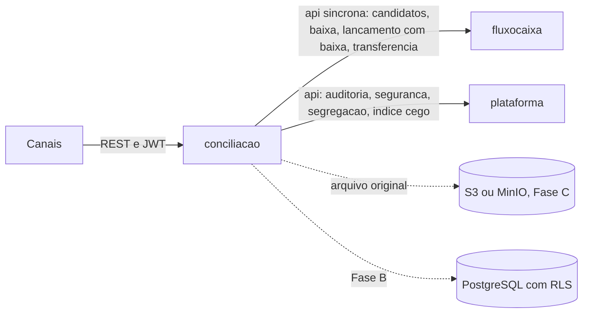

Texto equivalente: a conciliação recebe chamadas dos canais, usa a API do fluxo de caixa de forma síncrona para candidatos, baixas, lançamento com baixa e transferência, usa a API da plataforma para auditoria, segurança, segregação e índice cego, e guarda o arquivo original num armazenamento externo (memória na Fase A).

A conciliação **só enxerga `fluxocaixa.api`** (regra de arquitetura no build) e nunca lê ou grava tabelas do fluxo de caixa (CB-05). Convenções gerais (pipeline da requisição, erros, MFA, tenant, auditoria) estão em [JORNADA-TECNICA.md](JORNADA-TECNICA.md).

---

## 1. Jornada: cadastrar conta bancária **[Implementado]**

`POST /api/v1/conciliacao/contas` · Admin + MFA · `GET /contas` e `GET /contas/{id}` para os quatro papéis.

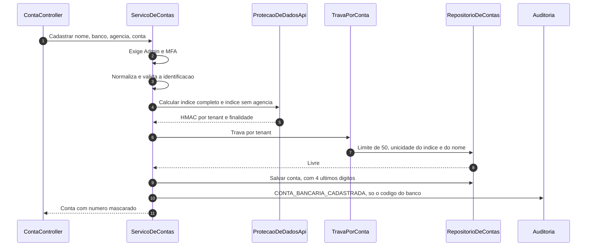

**Proteção do número** ([ADR 005](adr/005-indice-cego-numero-de-conta-nao-armazenado.md)): a agência e a conta nunca são persistidas. A normalização (maiúsculas, só letras e dígitos, sem zeros à esquerda) é a mesma no cadastro e na leitura do OFX, o que torna o reconhecimento por igualdade possível. O HMAC inclui tenant e finalidade; rotacionar a chave exige reindexar.

---

## 2. Jornada: importar o extrato **[Implementado]**

`POST /api/v1/conciliacao/importacoes` (multipart, Admin ou Operador, 20 por minuto) · `GET /importacoes/{id}?aguardar=30` · `GET /importacoes` · `POST /importacoes/{id}/reprocessamento` (Admin + MFA) · `GET /importacoes/{id}/arquivo` (Admin ou Auditor + MFA) · `GET /transacoes/{id}/origem`.

### 2.1 Recebimento (síncrono) e processamento (assíncrono)

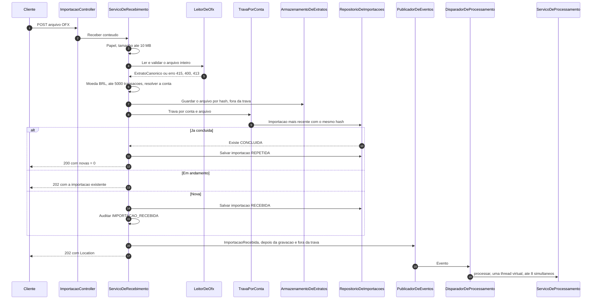

Decisões embutidas:
- **O arquivo inteiro é lido e validado no recebimento.** Qualquer erro recusa tudo, sem gravar. O parser OFX é próprio (SGML do 1.x, StAX do 2.x), sem DTD, sem entidades externas, com limites de profundidade, elementos e texto. A mensagem de erro nunca repete o conteúdo.
- **Gravar o arquivo vem antes da trava**, porque ele é endereçado por hash (gravar duas vezes é inofensivo) e o armazenamento externo pode demorar.
- **O evento sai depois de gravar e fora da trava.** Na Fase A não há transação e o consumidor roda assim que o evento sai; na Fase B a entrega passa a ser depois do commit, pelo registro persistente de eventos do Modulith.

### 2.2 Processamento em três tempos

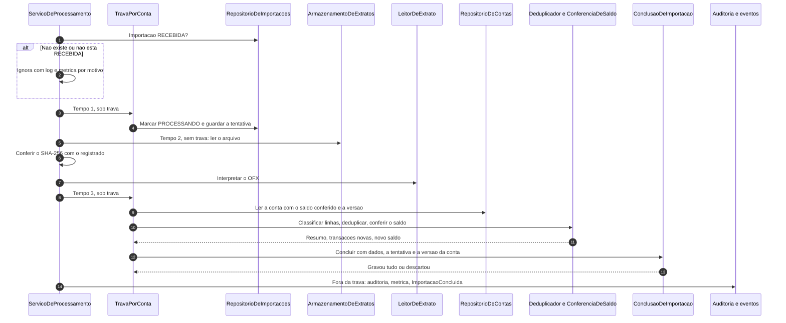

- **Atomicidade**: transações novas, importação concluída e saldo conferido da conta são gravados **juntos ou nada**. A porta `ConclusaoDeImportacao` recebe **dados** e carrega os agregados dentro da unidade atômica, para que "descartar" nunca deixe efeito (nem com entidades gerenciadas por JPA na Fase B).
- **Token de tentativa**: se a importação expirou ou foi reprocessada durante o processamento, o resultado é descartado sem gravar nada.
- **Conflito transitório** (conta alterada por outra operação, chave já existente) é repetido até 3 vezes antes de a importação falhar.
- **Falhas** viram `FALHOU` com código estável: `arquivo_indisponivel`, `arquivo_corrompido`, `capacidade_excedida`, `tempo_esgotado`, `erro_interno`.
- **Etapa pós-importação**: a porta `EtapaPosImportacao` (nula na U3a) é onde a U3b ligará o motor. Falha nela é contida e gera métrica; a importação continua concluída.

### 2.3 Estados da importação

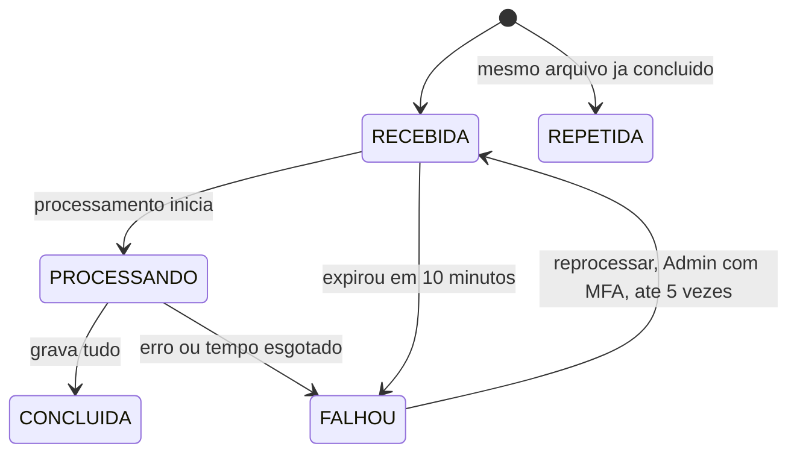

Um job a cada minuto expira importações sem andamento há mais de 10 minutos e alerta; nunca reprocessa sozinho. `aguardar` faz long-polling de até 30 s, com teto de esperas simultâneas por empresa.

### 2.4 Deduplicação ([ADR 006](adr/006-deduplicacao-por-fitid-com-conferencia-de-conteudo.md))

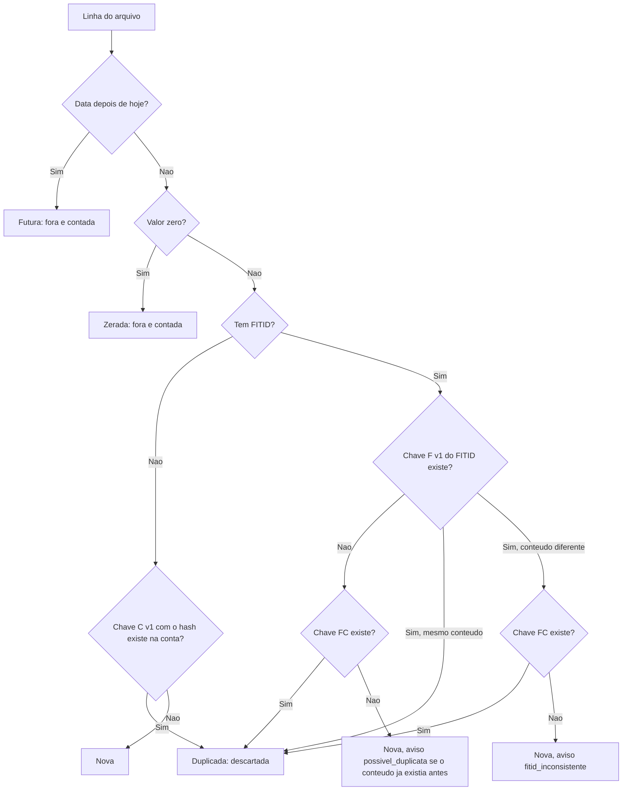

- O **hash** é SHA-256 de `v1 | conta | data | direção | centavos | descrição normalizada | ordinal`, com serialização explícita, e o **ordinal** conta ocorrências de linhas idênticas no arquivo.
- O FITID entra na chave **como hash**, para um valor com `:` não forjar a chave de outra linha. O formato é versionado e há testes com valor congelado.
- No máximo **duas consultas** ao repositório por importação (em lote). A unicidade (conta, chave) também é conferida na gravação, como última barreira.
- `linhasNoArquivo = novas + duplicadas + futuras + zeradas`, sempre.

### 2.5 Conferência de saldo

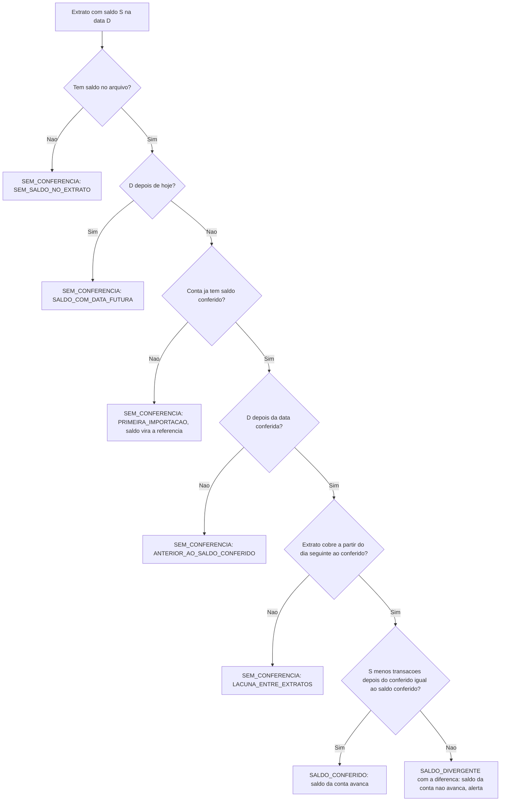

O OFX não traz saldo inicial: ele é **derivado** (saldo do banco menos as transações até a data do saldo) e o que se confere é a **continuidade** com o último saldo conferido. O saldo conferido da conta só avança em `SALDO_CONFERIDO` ou na `PRIMEIRA_IMPORTACAO`.

### 2.6 Baixar o arquivo original e rastrear a origem

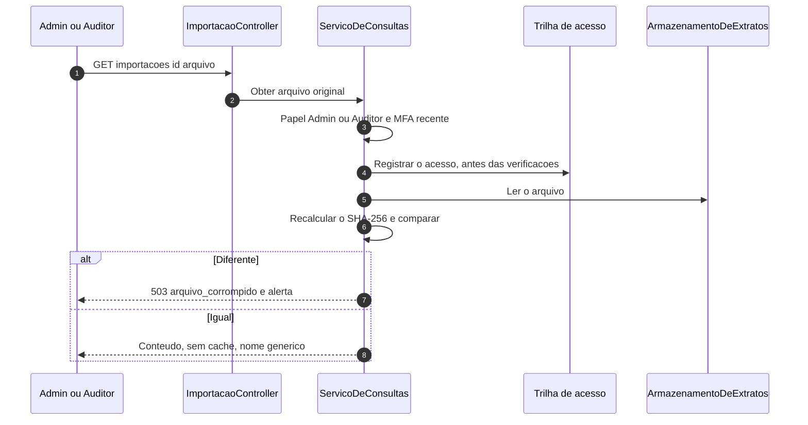

---

## 3. Jornada: conciliar **[Implementado, U3b]**

Os adaptadores continuam em memória (Fase A). As garantias de **ordem de gravação e repetição segura** não dependem de transação de banco: valem hoje e continuam valendo no PostgreSQL.

### 3.1 Motor em três camadas, logo depois da importação

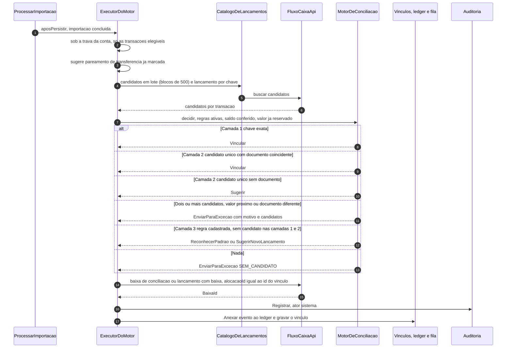

- **Regra de ouro**: com 2 ou mais candidatos a camada 2 nunca decide. Com saldo **divergente ou sem conferência**, o motor só sugere (e põe o item na fila com o motivo "saldo não conferido").
- O `MotorDeConciliacao` é **puro e determinístico**: sem I/O, sem IA (CB-07). Toda a decisão vive nele; o `ExecutorDoMotor` só traduz entradas em chamadas e executa. Isso permite testar as propriedades de segurança com milhares de casos gerados.
- O executor **reavalia a elegibilidade** de cada transação sob a trava dela, imediatamente antes de agir: se uma ação manual a alocou no meio-tempo, o motor a pula.
- **Ordem de gravação** (BR-LD-07): fluxo de caixa, auditoria, ledger, vínculo. O **identificador do vínculo é determinístico** (hash de tenant, transação, destino, valor e ordinal), e é também o `alocacaoId` enviado ao fluxo de caixa: se algo falhar depois da baixa, repetir chega ao mesmo identificador, o fluxo de caixa devolve a mesma baixa e o resto se completa. O ledger é idempotente por (vínculo, tipo de evento).
- Uma recusa ou indisponibilidade do fluxo de caixa deixa **só aquela transação** pendente (métrica `conciliacao.automacao`); reprocessar tenta de novo.
- Trava, na ordem: **conta bancária** (só o motor e a importação), **transação** (por identificador, quando o grupo tem duas), **fluxo de caixa**. O fluxo de caixa nunca chama a conciliação, então não há ciclo.

### 3.2 Alocar, criar da pendência e confirmar

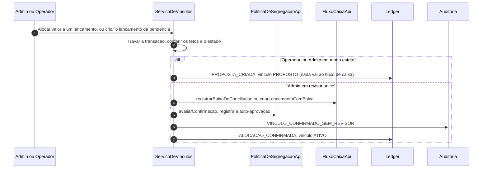

**Confirmar** (`ServicoDeConfirmacoes`, um ou lote de até 500, resultado parcial): para cada item, em ordem estável e de forma **independente**, o serviço carrega o vínculo, pergunta à segregação de funções se o confirmador pode (`sod_violation` auditado, antes de qualquer efeito), trava a transação (e a da outra ponta, em transferência e par), **revalida os tetos**, executa a baixa, a criação com baixa ou a transferência e só então audita, anexa ao ledger e grava. Falha de um item vai para a lista de recusas com o código; nunca aborta os demais. A confirmação por importação (`importacaoId`) pega as sugestões do sistema daquela importação, até o limite do lote, e informa quantas ficaram de fora.

**Criar da pendência** só vale pelo valor **inteiro** da transação (saldo livre igual ao valor). A categoria é a escolhida ou a sugestão em cadeia (3.5); em qualquer caso é validada (existe, ativa, aceita a direção). Só a escolha explícita é aprendida (`aprenderClassificacao`).

### 3.3 Transferência interna e par de estorno

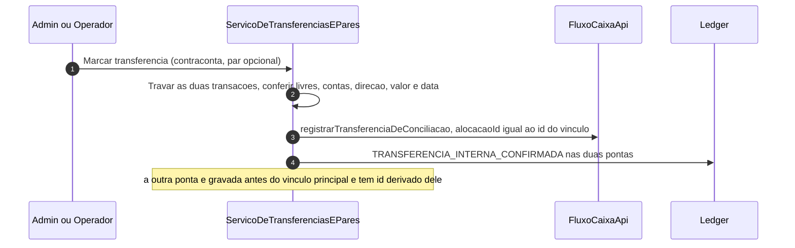

- **Dois vínculos por grupo** (um por transação), ligados pela mesma transferência (ou pelo `parDeTransacaoId`). O vínculo da outra ponta é gravado **antes** do principal, com identificador derivado do principal e ordinal fixo: repetir depois de uma falha no meio converge.
- **Pareamento posterior**: se a outra ponta ainda não foi importada, o vínculo existe só para a transação marcada. Quando outra transação compatível (outra conta, contraconta igual a esta conta, direção oposta, valor igual, data dentro da tolerância) é importada, o motor cria uma **sugestão** ligada à mesma transferência; confirmar liga, sem registrar outra transferência. Só com **um** candidato; sugestão rejeitada não volta.
- **Par de estorno**: duas transações da mesma conta, direção oposta, valor igual; só ledger, sem chamar o fluxo de caixa.
- Operador propõe e Admin confirma (segregação). A outra ponta só nasce na confirmação, que revalida que ela continua livre.

### 3.4 Desfazer

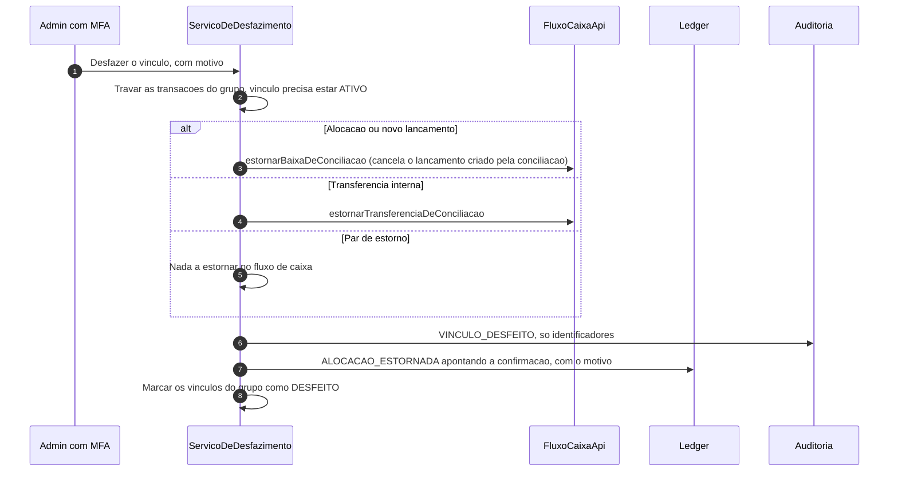

- Estorna **só a baixa do próprio vínculo**; uma baixa manual do usuário nunca é tocada. Baixa ou transferência **já estornada** (tentativa anterior parou no meio) é tratada como já concluída (BR-DS-06).
- Em grupo, os membros são gravados em sequência. Se a gravação parar entre eles, repetir pelo membro ainda ativo conclui; o já desfeito responde `vinculo_nao_ativo`.

### 3.5 Regras de reconhecimento e sugestão de categoria

- **Regras** (`ServicoDeRegras`): só Admin com MFA escreve; a categoria precisa ser de resultado financeiro ou despesa operacional, ativa e da mesma direção; uma ativa por (padrão, direção), até 100 ativas; nunca excluída. A auditoria leva só identificadores (nunca o padrão).
- **Camada 3**: a regra de padrão mais longo cria lançamento e baixa na categoria dela (ator sistema, `RECONHECIMENTO_DE_PADRAO`, `regraId` no ledger); com saldo não conferido só sugere. Desfazer cancela o lançamento criado.
- **Sugestão em cadeia** (`SugestorDeCategoriaEmCadeia`): regra aprendida do usuário, depois a tabela fixa (tarifas, rendimentos, estorno, resolvidas pela categoria padrão no fluxo de caixa). Só sugere.

### 3.6 Ignorar e reativar

Ignorar (Admin, MFA, motivo) só vale sem vínculo ativo; rejeita, em nome do sistema, as sugestões e propostas abertas e anexa `TRANSACAO_IGNORADA`. O estado ignorado é o último evento entre ignorar e reativar no ledger, então reativar devolve a transação ao que o resto dos fatos diz (pendente ou em exceção).

### 3.7 Consultas

`ServicoDeConsultaDeConciliacao` só lê. A situação de cada transação é **derivada** (soma dos vínculos ativos, ignorada pelo ledger, item na fila) por consultas de custo constante, sem carregar agregado de vínculo; o repositório de transações mantém um índice por data e identificador (`noPeriodo`) e devolve as instâncias guardadas, imutáveis. Pendências detalham só a página (candidatos numa chamada em lote ao fluxo de caixa; se ele não responde, a lista sai com `candidatosIndisponiveis`). O Consultor BPO lê a situação de outra empresa só se ela estiver na claim `bpo_tenants`. Leituras de Auditor e Consultor BPO geram log de acesso sem o conteúdo.

O ledger, a fila de exceções, os vínculos e as transações são **sem exclusão**; uma regra de arquitetura no build proíbe métodos de alteração e exclusão nas portas do ledger e da fila.

---

## 4. Mapa de endpoints

Prefixo `/api/v1/conciliacao`. Toda escrita exige `Idempotency-Key`. Papel e MFA são verificados no endpoint **e** no caso de uso.

| Método e caminho | Papéis | MFA | Resposta |
|---|---|---|---|
| `POST /contas` | Admin | sim | 201 |
| `GET /contas`, `/contas/{id}` | todos | não | 200 |
| `POST /importacoes` | Admin, Operador | não | 202 |
| `GET /importacoes`, `/importacoes/{id}?aguardar=` | todos | não | 200 |
| `POST /importacoes/{id}/reprocessamento` | Admin | sim | 202 |
| `GET /importacoes/{id}/arquivo` | Admin, Auditor | sim | 200 |
| `GET /transacoes/{id}/origem` | todos | não | 200 |
| `POST /transacoes/{id}/alocacoes` | Admin (ativo ou proposto), Operador (propõe) | Admin: sim | 201 |
| `POST /transacoes/{id}/baixa-existente` (M15) | Admin (ativo ou proposto), Operador (propõe) | Admin: sim | 201 |
| `POST /transacoes/{id}/lancamento` | Admin, Operador (propõe) | Admin: sim | 201 |
| `POST /transacoes/{id}/transferencia-interna` | Admin, Operador (propõe) | Admin: sim | 201 |
| `POST /transacoes/{id}/estorno` | Admin, Operador (propõe) | Admin: sim | 201 |
| `POST /transacoes/{id}/ignorar`, `/reativar` | Admin | sim | 204 |
| `POST /vinculos/confirmacoes` | Admin | sim | 200 (resultado parcial) |
| `POST /vinculos/{id}/rejeicao` | Admin | sim | 204 |
| `POST /vinculos/{id}/desfazer` | Admin | sim | 204 |
| `GET /regras-de-reconhecimento` | todos | não | 200 |
| `POST /regras-de-reconhecimento`, `/{id}/ativacao`, `/{id}/desativacao` | Admin | sim | 201 / 200 |
| `GET /pendencias` | todos | não | 200 |
| `GET /situacao?conta&de&ate[&tenant]` | todos (BPO com `tenant`) | não | 200 |
| `GET /transacoes/{id}/historico`, `/lancamentos/{id}/historico` | todos | não | 200 |
| `GET /transacoes/{id}/baixas-compativeis` (M15) | todos | não | 200 |

O Operador cria **propostas** pelos mesmos endpoints de escrita (a resposta traz o vínculo `PROPOSTO`). Códigos de erro estáveis, entre outros: `alocacao_acima_da_transacao`, `alocacao_acima_do_em_aberto` (422), `lancamento_quitado`, `vinculo_nao_pendente`, `vinculo_nao_ativo`, `transacao_ignorada`, `transacao_com_vinculo`, `transacao_parcialmente_alocada`, `regra_duplicada`, `par_ja_conciliado` (409), `sod_violation` (403), `categoria_obrigatoria`, `categoria_inativa`, `categoria_nao_permitida_para_regra`, `contas_iguais`, `par_incompativel`, `periodo_invalido`, `lote_grande_demais` (422).

## 5. Dados e persistência

- **Hoje (Fase A)**: repositórios em memória, isolados por tenant, que guardam e devolvem cópias, conferem versão e recusam escrita de outro tenant dentro da operação. A conclusão da importação usa um monitor único sobre contas, importações e transações para ser atômica.
- **Fase B**: PostgreSQL com `tenant_id` e RLS, tabelas `con_*`; `ledger_conciliacao` sem `UPDATE` nem `DELETE`; estado da transação **não é coluna** (derivado dos vínculos ativos); teto de alocação por trava da transação.
- **O que a Fase B troca na U3b**: a trava por transação (hoje monitor em memória) vira trava de linha ou advisory lock; `noPeriodo` e a situação do período viram agregação SQL com índices `(tenant, conta, data)`; o índice de grupo por transferência vira índice por `transferencia_id`; a entrega dos eventos passa a ser depois do commit. As metas de desempenho (pendências e situação em até 500 ms com 50 mil transações) foram medidas em memória e precisam do teste de carga contra o PostgreSQL (risco RK-U3b-1).
- **Pendências para a Fase B**: fronteira transacional do recebimento (porta de unidade de trabalho), consultas entre tenants do job de expiração e do indicador sob RLS, entrega dos eventos depois do commit, ciclo de vida de dados pessoais ([ADR 011](adr/011-retencao-e-eliminacao-de-dados-pessoais.md)).

## 6. Observabilidade

- **Métricas da U3b** (Micrometer, sem tenant, usuário, valor, descrição nem documento): `conciliacao.operacao` por operação e resultado (uma por caso de uso: alocar, confirmar, desfazer, ignorar, consultas...), `conciliacao.motor` por camada e resultado, `conciliacao.fila` por motivo, `conciliacao.automacao` por resultado, `conciliacao.motor.duracao`. Os nomes diferem dos rascunhos do BR-AP-03 (`conciliacao.vinculo`, `conciliacao.consulta`): a operação virou rótulo de `conciliacao.operacao`.
- **Métricas** (Micrometer): `conciliacao.importacao` por resultado, `conciliacao.importacao.processamento`, `...espera`, `...linhas`, `conciliacao.importacao.saldo` por situação, `conciliacao.importacao.descartada` e `conciliacao.processamento.ignorado` por motivo, `conciliacao.etapa_pos_importacao.falhou`. Tags de baixa cardinalidade, nunca tenant, conta ou usuário.
- **Alertas**: importação parada (gauge da idade da mais antiga em andamento), saldo divergente, arquivo corrompido, importação falhou ou expirou.
- **Spans**: `conciliacao.receber_extrato`, `conciliacao.processar_importacao`, `conciliacao.expirar_importacoes` e, na U3b, um por caso de uso (`conciliacao.alocar`, `conciliacao.confirmar`, `conciliacao.desfazer`, `conciliacao.listar_pendencias`...).
- **Logs** sem PII: nunca número de conta, descrição, valor, nome de arquivo ou trecho do OFX; só contagens, códigos e identificadores técnicos.

## 7. Onde está o código

| O quê | Onde |
|---|---|
| Domínio: agregados, deduplicação, conferência de saldo | `application/conciliacao/src/main/java/.../conciliacao/domain` |
| Casos de uso e portas | `.../conciliacao/application` |
| Parser OFX (SGML 1.x e StAX 2.x), repositórios, web | `.../conciliacao/infrastructure` |
| Contratos publicados (ids e eventos) | `.../conciliacao/api` |
| Motor puro, vínculo, ledger, estado derivado, extração de documento | `.../conciliacao/domain` (`MotorDeConciliacao`, `Vinculo`, `EventoDoLedger`, `CalculadoraDeAlocacao`, `ExtratorDeDocumentoEChaves`) |
| Execução do motor, alocar, confirmar, desfazer, transferência, ignorar, regras, consultas | `.../conciliacao/application` (`ExecutorDoMotor`, `ServicoDeVinculos`, `ServicoDeConfirmacoes`, `ServicoDeDesfazimento`, `ServicoDeTransferenciasEPares`, `ServicoDeIgnoradas`, `ServicoDeRegras`, `ServicoDeConsultaDeConciliacao`) |
| Regras de negócio da U3a (RC-nn) | `aidlc-docs/construction/u3a-conciliacao-importacao/functional-design/business-rules.md` |
| Regras de negócio da U3b (BR-xx-nn) e resumo da construção | `aidlc-docs/construction/u3b-conciliacao-motor-vinculos/` (`functional-design/business-rules.md`, `code/code-summary.md`) |
| Decisão de arquitetura da U3b | [ADR 013](adr/013-vinculo-ledger-insert-only-e-identificador-deterministico.md) |
| Regras oficiais v2 (CB-nn) | `docs/sdd/rules/REGRAS-CONCILIACAO-BANCARIA.md` |
| Desenho da U3b | `aidlc-docs/inception/application-design/` |
