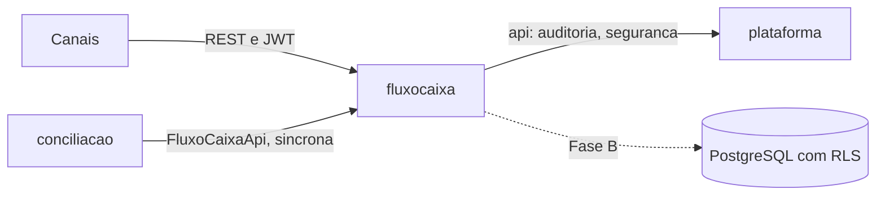
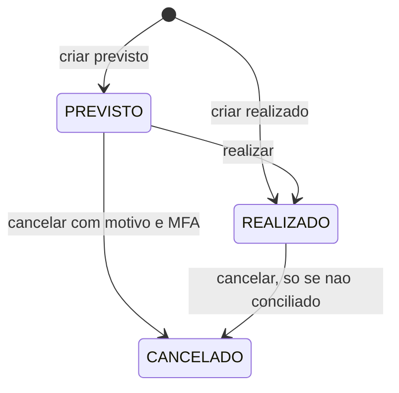
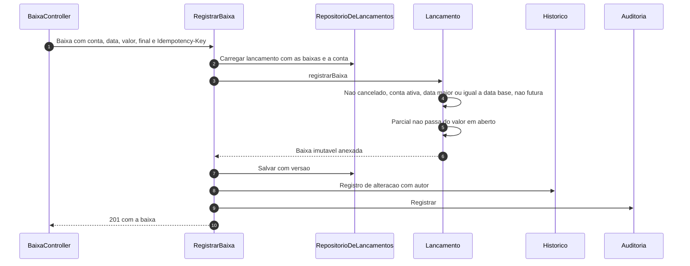

# Jornada Técnica — Fluxo de Caixa

**Versão**: 1.1 · **Data**: 2026-10-04 · **Produto**: Agente de Bolso
**Para quem**: engenheiros que vão manter, integrar ou revisar o módulo `fluxocaixa` (backend, integradores de canal, SRE, segurança).
**Documentos irmãos**: [Conciliação](JORNADA-TECNICA-CONCILIACAO.md) · [Plataforma e visão geral](JORNADA-TECNICA.md) (requisição, idempotência, auditoria, segregação, dados, observabilidade) · usuário final: [Manual de Fluxo de Caixa](MANUAL-FLUXO-DE-CAIXA.md).

## Como ler

| Selo | Significado |
|---|---|
| **[Implementado]** | Está no código e coberto por testes (U2 e U2b; `./mvnw verify` verde) |
| **[Desenhado]** | Aprovado, ainda sem código (persistência definitiva, Fase B) |

## Onde o fluxo de caixa se encaixa



Texto equivalente: os canais chamam a API REST do fluxo de caixa; a conciliação o usa por uma API síncrona; ele usa a plataforma para auditoria e segurança. O fluxo de caixa **não conhece a conciliação** (regra de arquitetura no build): na baixa, guarda só uma referência opaca de origem (tipo e id). Convenções gerais (pipeline da requisição, erros, MFA, tenant, auditoria) estão em [JORNADA-TECNICA.md](JORNADA-TECNICA.md).

---

## 1. Jornada: lançamentos e categorias **[Implementado, modelo da primeira versão]**

`/api/v1/fluxo-caixa/lancamentos` (`POST`, `GET`, `GET /{id}`, `PATCH /{id}`, `POST /{id}/realizacao`, `POST /{id}/cancelamento`) e `/categorias` (`GET`, `POST`, `PATCH /{id}`, `POST /{id}/desativacao`, `POST /{id}/reativacao`). Escrita só Admin (cancelar exige MFA); leitura para os quatro papéis.



- O valor trafega como **texto** (`"350.00"`); número JSON é rejeitado. Internamente é `long` em centavos, nunca ponto flutuante.
- `PATCH` exige o campo `versao` (lock otimista); versão antiga responde 409.
- **Conciliado** é uma marca à parte do estado: com ela, valor, direção e datas não mudam.
- O **plano de contas** (20 categorias (plano **provisório**, a validar pelo contador: BR-CG-09)) é provisionado uma única vez por empresa, de forma idempotente, na primeira chamada de qualquer caso de uso do módulo, mesmo sob concorrência.
- `FluxoCaixaApi` (consumida pela conciliação): buscar candidatos (individual e em lote), buscar por identificador externo, criar realizado conciliado, marcar e desmarcar conciliado, sugerir e aprender classificação, categoria padrão.

### Fluxo de caixa completo **[Implementado, U2b]**



A **situação** (Previsto, Parcial, Pago, Vencido, Cancelado) é calculada na leitura pelo serviço `SituacaoDoLancamento`, com a data de hoje; **saldo** e **projeção** usam consultas agregadas no banco, sem carregar agregados (meta de 500 ms no p95 com 50 mil baixas). A **diferença de liquidação** é calculada (soma das baixas ativas menos o previsto), não gravada.

---

## 2. Contrato com a conciliação: `FluxoCaixaApi`

**[Implementado, versão da U2]** buscar candidatos (individual e em lote), buscar por identificador externo, obter, criar realizado conciliado, marcar e desmarcar conciliado, sugerir e aprender classificação, categoria padrão.

**[Implementado, U2b]** a "marcação de conciliado" foi substituída por operações de **baixa**, todas idempotentes pelo identificador da alocação (chave natural); o mesmo `alocacaoId` com conteúdo diferente é 409 `alocacao_conflitante`:

| Operação | O que faz |
|---|---|
| `buscarCandidatos` e `buscarCandidatosEmLote` | Candidatos por **valor em aberto**, direção e janela |
| `buscarPorChaveDeCobranca` e `obter` | Consulta por identificador externo e por id |
| `registrarBaixaDeConciliacao` | Baixa de origem conciliação; repetir devolve a mesma baixa; acima do em aberto é recusada |
| `criarLancamentoComBaixa` | Cria o lançamento (origem conciliação) e a baixa final, atomicamente |
| `estornarBaixaDeConciliacao` | Só baixas de origem conciliação; pode cancelar o lançamento criado pela conciliação (nunca um lançamento manual) |
| `registrarTransferenciaDeConciliacao` e `estornarTransferenciaDeConciliacao` | Transferência entre contas próprias |
| `criarContaFinanceiraBancaria` e `contaFinanceira` | Conta financeira bancária e sua consulta (tipo, ativa, data base) |

A conta bancária da conciliação aponta para uma conta financeira `BANCARIA` ativa, no máximo uma por conta financeira (409 `conta_financeira_ja_ligada`); ver [ADR 012](adr/012-baixas-imutaveis-situacao-derivada-e-travas.md).

Uma **suíte de contrato reutilizável** (`ContratoDaFluxoCaixaApiTest`) valida a API; o adaptador real a executa, e a conciliação testa contra um dublê mínimo (`FluxoCaixaApiFalsa`).

## 3. Mapa de endpoints **[Implementado]**

Toda escrita exige `Idempotency-Key` ([ADR 008](adr/008-idempotencia-de-escrita.md)). Valores trafegam como texto (`"350.00"`).

| Método e caminho | Papéis | MFA |
|---|---|---|
| `POST`, `GET`, `GET /{id}`, `PATCH /{id}` em `/api/v1/fluxo-caixa/lancamentos` | escrita Admin, leitura todos | não |
| `GET /api/v1/fluxo-caixa/lancamentos/{id}/historico` | todos | não |
| `POST /api/v1/fluxo-caixa/lancamentos/{id}/cancelamento` | Admin | sim |
| `POST /api/v1/fluxo-caixa/lancamentos/{id}/baixas` | Admin | não |
| `POST /api/v1/fluxo-caixa/baixas/{id}/estorno` | Admin | sim |
| `PUT` e `PATCH /api/v1/fluxo-caixa/baixas/{id}` | sempre 409 `baixa_imutavel` | |
| `POST`, `GET`, `GET /{id}`, `/inativacao`, `/reativacao` em `/api/v1/fluxo-caixa/contas-financeiras` | escrita Admin, leitura todos | criar e inativar: sim |
| `POST`, `GET`, `GET /{id}`, `POST /{id}/estorno` em `/api/v1/fluxo-caixa/transferencias` | escrita Admin, leitura todos | estorno: sim |
| `GET /api/v1/fluxo-caixa/contas-financeiras/{id}/saldo`, `/saldos`, `/projecao` | todos | não |
| `GET`, `POST`, `PATCH /{id}`, `/desativacao`, `/reativacao`, `PATCH /{id}/atividade-da-dfc` em `/api/v1/fluxo-caixa/categorias` | escrita Admin, leitura todos | não |

A fonte da verdade dos papéis é o oráculo `AutorizacaoDoFluxoDeCaixaOraculoTest` (22 endpoints, 1056 casos), que quebra o build se um endpoint novo não declarar papéis.

### Exemplo: baixa parcial com `curl`

```bash
curl -X POST "$HOST/api/v1/fluxo-caixa/lancamentos/$LANCAMENTO/baixas" \
  -H "Authorization: Bearer $TOKEN" \
  -H "Idempotency-Key: 6f1c2a7e-baixa-0001" \
  -H "Content-Type: application/json" \
  -d '{"contaFinanceiraId":"'$CONTA'","valor":"350.00","dataDePagamento":"2026-10-01","baixaFinal":false}'
```

Repetir o comando com a mesma chave devolve a mesma resposta com `Idempotent-Replayed: true`, sem nova baixa. Para corrigir um erro, nunca se altera a baixa: `POST /api/v1/fluxo-caixa/baixas/$BAIXA/estorno` com o motivo, e depois uma baixa nova.

## 4. Dados e persistência

- **Hoje (Fase A)**: repositórios e travas em memória, com tetos de capacidade (200 mil lançamentos por empresa, 5 milhões no total, alerta em 80%).
- **Fase B**: PostgreSQL com `tenant_id` e RLS, tabelas `fcx_*`; `baixa`, `estorno_de_baixa` e `historico_lancamento` sem `UPDATE` nem `DELETE`; **sem coluna de situação** (calculada na consulta); saldo e projeção por agregações no banco.

## 5. Observabilidade

- **Métricas**: `fluxocaixa.lancamento.operacao` por operação e resultado; `fluxocaixa.candidatos.busca` (timer). Sem tag de tenant, usuário, valor ou texto.
- **Auditoria**: `LANCAMENTO_CRIADO`, `_ALTERADO`, `_REALIZADO`, `_CANCELADO`, `_CONCILIADO`, `_CONCILIACAO_DESFEITA`; `CATEGORIA_*`; `PLANO_DE_CONTAS_PROVISIONADO`. `contraparte` e `descricao` nunca entram.
- **Eventos [Implementado]**: lançamento criado, alterado e cancelado; baixa registrada e estornada; transferência registrada e estornada. Nunca levam valores ou textos. O alerta de liquidez fica para a unidade de alertas (não emitido na U2b).

## 6. Onde está o código

| O quê | Onde |
|---|---|
| Domínio: lançamento, categoria, regras, seleção de candidatos | `application/fluxocaixa/src/main/java/.../fluxocaixa/domain` |
| Casos de uso e portas | `.../fluxocaixa/application` |
| Repositórios em memória, web | `.../fluxocaixa/infrastructure` |
| Contratos publicados | `.../fluxocaixa/api` |
| Suíte de contrato da API | `application/fluxocaixa/src/test/java/.../ContratoDaFluxoCaixaApiTest` |
| Regras de negócio da U2 | `aidlc-docs/construction/u2-fluxocaixa/functional-design/business-rules.md` |
| Regras oficiais v2 (FC-nn) | `docs/sdd/rules/REGRAS-FLUXO-DE-CAIXA.md` |
