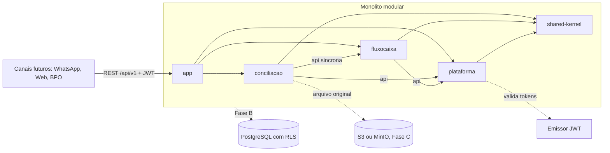
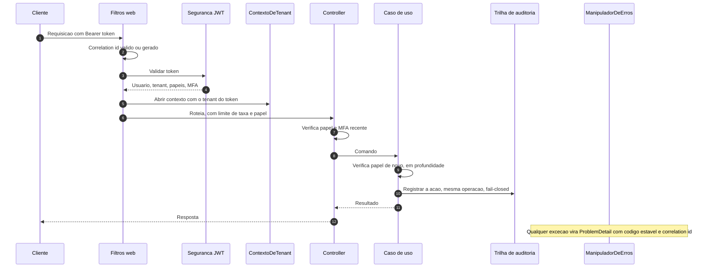
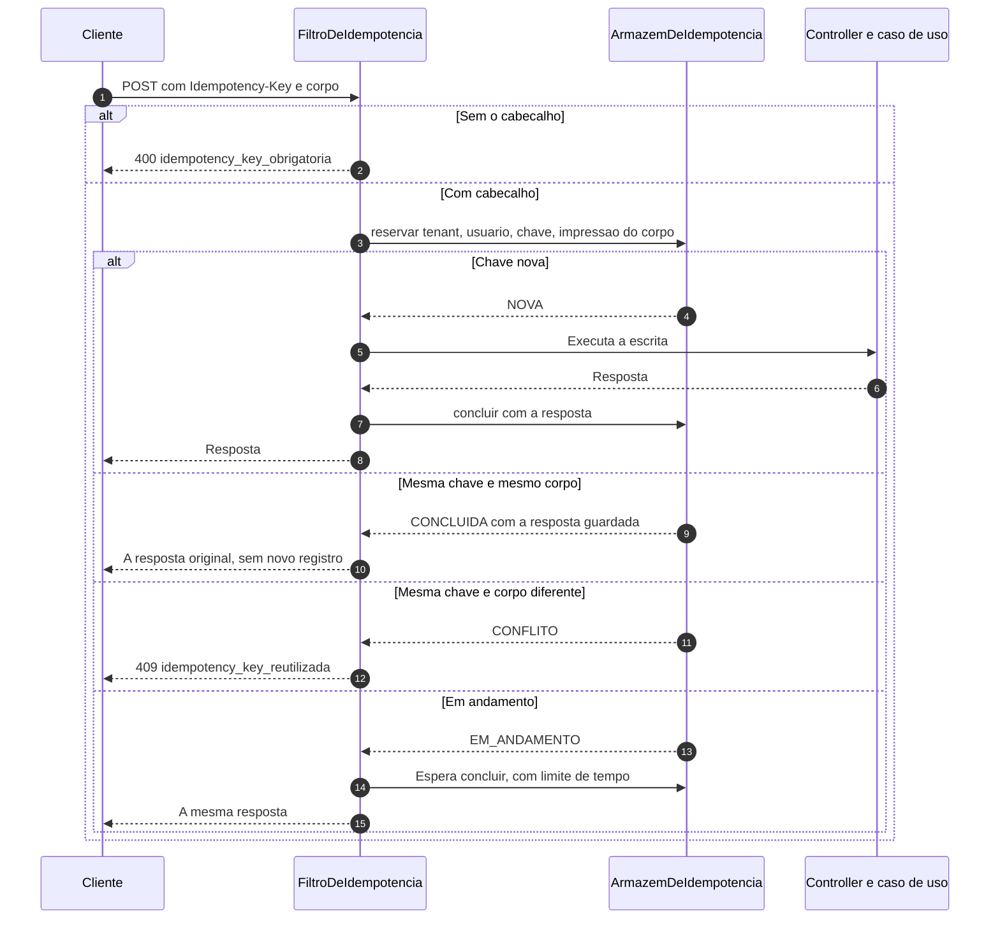
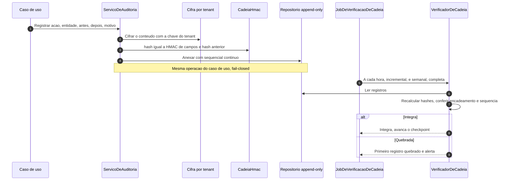
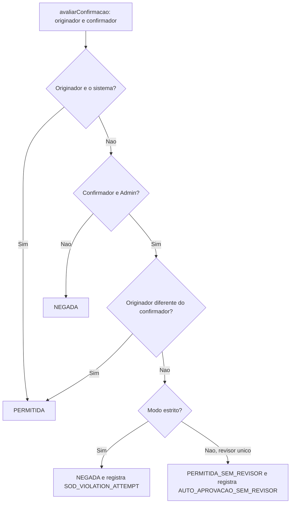

# Jornada Técnica — Plataforma e Visão Geral

**Versão**: 2.0 · **Data**: 2026-10-03 · **Produto**: Agente de Bolso
**Para quem**: engenheiros que vão manter, integrar ou revisar o produto (backend, integradores de canal, SRE, segurança).

A jornada técnica é dividida por **domínio**. Este documento traz o que é comum a todos; o detalhe de cada domínio está em:

| Documento | Conteúdo |
|---|---|
| **[Fluxo de Caixa](JORNADA-TECNICA-FLUXO-DE-CAIXA.md)** | Lançamentos, categorias, baixas, saldo, projeção e a `FluxoCaixaApi` |
| **[Conciliação Bancária](JORNADA-TECNICA-CONCILIACAO.md)** | Conta bancária, importação OFX, deduplicação, conferência de saldo, motor de conciliação, desfazer |

Usuário final: [Manual](MANUAL-DO-USUARIO.md). Regras: [Regras de Negócio](REGRAS-DE-NEGOCIO.md). Subir e usar localmente: [Manual Técnico](MANUAL-TECNICO.md). O que é testado: [Cenários de teste](testes/README.md).

## Como ler

| Selo | Significado |
|---|---|
| **[Implementado]** | Está no código e coberto por testes (U1, U1b, U2, U2b, U3a e U3b; `./mvnw verify` verde) |
| **[Desenhado]** | Aprovado, ainda sem código (persistência definitiva, Fase B). Os diagramas mostram o contrato aprovado, não código existente |

Os nomes de classes seguem o código; os nomes das portas e dos serviços do desenho v2 estão em `aidlc-docs/inception/application-design/`.

---

## 1. Visão técnica

Monolito modular em **Java 25**, **Spring Boot 4**, **Spring Modulith**, arquitetura **hexagonal** por módulo, persistência **em memória** na Fase A (PostgreSQL com RLS na Fase B, AWS na Fase C, ver [ADR 003](adr/003-persistencia-em-fases.md)).



Texto equivalente: os canais chamam a API REST do módulo `app`, que monta `conciliacao`, `fluxocaixa` e `plataforma`. A conciliação chama o fluxo de caixa por uma API síncrona e a plataforma por sua API; o fluxo de caixa também usa a plataforma; todos usam o `shared-kernel`.

| Módulo | Papel |
|---|---|
| `shared-kernel` | Valores em Java puro: `Dinheiro` (centavos, sempre positivo), `ValorComSinal`, `Direcao`, `TenantId`, `UsuarioId`, `Periodo`, `DescricaoNormalizada`, `Papel`, `Pagina` |
| `plataforma` | Segurança (JWT, papéis, MFA), tenancy (`ScopedValue`), auditoria com cadeia HMAC, segregação de funções, erros (ProblemDetail), observabilidade, proteção de dados (índice cego) |
| `fluxocaixa` | Lançamentos, categorias, regras de classificação e a `FluxoCaixaApi` |
| `conciliacao` | Contas bancárias, importação OFX, deduplicação, conferência de saldo, consultas |
| `app` | Aplicação executável, perfis, testes de arquitetura e de integração |

**Camadas dentro de cada módulo**: `api` (contratos publicados), `domain` (sem Spring nem JPA), `application` (casos de uso e portas), `infrastructure` (web, adaptadores). O build falha se o domínio importar framework, se um módulo acessar o interior de outro, se o fluxo de caixa conhecer a conciliação, se a conciliação usar algo além de `fluxocaixa.api`, ou se uma porta de repositório oferecer exclusão física.

---

## 2. O caminho de toda requisição **[Implementado]**



Pontos a saber:
- **Deny-by-default**: endpoint sem papel declarado não é acessível.
- O **tenant vem só do token**. Recurso de outro tenant responde **404**.
- **MFA** é verificado pelo `amr` do token e pela idade da autenticação (padrão 15 minutos); sem ele, 403 `mfa_required` com `max_age`.
- Toda **escrita de negócio** audita na mesma operação; se a auditoria falha, a ação falha.
- Erros saem como **ProblemDetail** (RFC 9457) com `codigo` estável e `correlationId`. Nunca stack trace, SQL ou nome de classe. 400 validação, 401, 403, 404, 409 conflito, 422 regra violada, 429 limite de taxa, 503 indisponível.
- Logs, métricas e spans **não levam PII**. O tenant aparece pseudonimizado. **Exceção no log**: nunca se grava o `Throwable` cru (a mensagem e as das causas podem trazer dado de entrada); o log leva `error.type`, `error.message` e `error.stack_trace` já passados pelo `LogSanitizer` (`plataforma.api`, a única implementação: mascara cartão, CNPJ, CPF, telefone, e-mail, token e valor em reais, limita o tamanho e é idempotente). Vale para o erro inesperado e para a falha da verificação da cadeia; os demais jobs só logam o tipo.

### Reenvio seguro **[Implementado, U1b]**



A chave vale 24 horas por empresa e usuário. **Só resposta 2xx fica guardada**; qualquer outra libera a chave. Chaves naturais no domínio (hash do arquivo, identificador da alocação) são a segunda barreira.

Como está implementado (pacote `plataforma.idempotencia`):
- `FiltroDeIdempotencia` roda dentro da cadeia de segurança, **depois** de `FiltroDeContexto` (usuário e tenant já no contexto) e antes do controller. Requisição sem autenticação passa direto e leva o 401 de sempre.
- A **impressão** é o SHA-256 de método, caminho, consulta ordenada, tipo de conteúdo e corpo normalizado (JSON com chaves ordenadas; multipart por nome, tipo e SHA-256 do conteúdo de cada parte, sem o separador nem o nome do arquivo).
- A **identidade** é o HMAC de (tenant, usuário, chave); a chave bruta não é guardada. A resposta guardada é cifrada com a chave do tenant (a mesma da auditoria).
- `ArmazemDeIdempotenciaEmMemoria`: reserva atômica por `compute`, espera por `CompletableFuture` (sem polling), tetos de registros, bytes e esperas, falha fechada.
- A reserva sem conclusão vence em 5 minutos; um job remove os vencidos a cada minuto. O reenvio e a espera contam no limite de taxa do tenant.
- O contrato OpenAPI mostra o cabeçalho como obrigatório em toda escrita.
- Fase B: a reserva e a resposta passam a ser gravadas na mesma transação da escrita.

---

## 3. Trilha de auditoria e verificação **[Implementado]**



A verificação **não precisa da chave do tenant**, então continua valendo depois do crypto-shredding ([ADR 002](adr/002-auditoria-cadeia-hmac-crypto-shredding.md)). `GET /api/v1/plataforma/auditoria/verificacao` executa sob demanda (Admin ou Auditor, MFA).

## 4. Segregação de funções **[Implementado]**



`GET /api/v1/plataforma/segregacao/modo`, `PUT .../modo` (Admin + MFA, motivo de 20+ caracteres), `GET .../relatorio`. O modo estrito liga sozinho quando o segundo Admin ativo aparece; nunca volta sozinho ([ADR 004](adr/004-maker-checker-revisor-unico.md)).

---

## 5. Mapa de endpoints da plataforma **[Implementado]**

| Método e caminho | Papéis | MFA |
|---|---|---|
| `GET /api/v1/plataforma/auditoria/verificacao` | Admin, Auditor | sim |
| `GET`, `PUT /api/v1/plataforma/segregacao/modo`; `GET .../relatorio` | conforme a regra | PUT sim |
| `GET /api/v1/plataforma/usuarios` | Admin, Auditor | não |
| `POST /api/v1/plataforma/usuarios/{id}/desativacao` e `/reativacao` | Admin | sim |

Os endpoints de cada domínio estão no documento do domínio. O contrato completo (OpenAPI) fica em `/swagger-ui.html` fora de produção. Toda escrita de qualquer domínio passará a exigir `Idempotency-Key` (U1b).

## 6. Dados, tenancy e persistência

- **Hoje (Fase A)**: tudo em memória, com adaptadores marcados `AdaptadorEmMemoria`; o perfil `prod` **não sobe** com eles. Cada repositório isola por tenant, guarda e devolve cópias, confere versão e recusa escrita de outro tenant dentro da operação.
- **Fase B**: PostgreSQL com `tenant_id` e **RLS** (`SET LOCAL app.tenant_id` por transação), Flyway por módulo, JPA, Testcontainers. Tabelas de ledger, auditoria, baixa, estorno e histórico **sem `UPDATE` nem `DELETE`** (regra de arquitetura no build).
- **Fase C**: AWS (S3 com SSE e Object Lock de retenção finita, KMS para as chaves).
- Pendências por domínio para a Fase B estão nos documentos de [Fluxo de Caixa](JORNADA-TECNICA-FLUXO-DE-CAIXA.md#4-dados-e-persistência) e de [Conciliação](JORNADA-TECNICA-CONCILIACAO.md#5-dados-e-persistência). Comum aos dois: o ciclo de vida de dados pessoais ([ADR 011](adr/011-retencao-e-eliminacao-de-dados-pessoais.md)).

## 7. Observabilidade e operação

- **Logs** JSON (ECS) com `correlationId`, `event.action` estável e **sem PII**; o `X-Correlation-Id` do cliente só é aceito em hexadecimal e hífen. O tenant aparece pseudonimizado.
- **Métricas** (Micrometer) com tags de baixa cardinalidade, nunca tenant ou usuário. As métricas de cada domínio estão em [Fluxo de Caixa](JORNADA-TECNICA-FLUXO-DE-CAIXA.md#5-observabilidade) e [Conciliação](JORNADA-TECNICA-CONCILIACAO.md#6-observabilidade).
- **Alertas da plataforma**: cadeia de auditoria quebrada, job de verificação com falha ou atrasado, violação de segregação de funções, mudança de modo de segregação.
- **Actuator** em porta separada; Swagger e exportação OTLP desligados por padrão em produção.

## 8. Rodar e testar

```bash
cd application
./mvnw verify          # testes, propriedades, arquitetura, cobertura, SpotBugs e FindSecBugs
```

Gates do build: cobertura mínima de 80% em domínio e aplicação; varredura de dependências no CI contra a [National Vulnerability Database (NVD)](https://nvd.nist.gov/) (falha com CVSS 7 ou mais), além do CodeQL; ArchUnit e verificação do Modulith; testes de propriedade (jqwik) para deduplicação, saldo, tetos e repetição; oráculos exaustivos de autorização; teste de integração que prova a ausência de PII nos logs; teste que barra PII nas fixtures de OFX. Passo a passo para subir localmente, gerar token e chamar a API: [application/README.md](../application/README.md).

## 9. Onde está o código

| O quê | Onde |
|---|---|
| Segurança, tenancy, auditoria, segregação, erros, observabilidade | `application/plataforma/src/main/java/.../plataforma` |
| Valores e identificadores compartilhados | `application/shared-kernel/src/main/java/.../sharedkernel` |
| Regras de arquitetura e testes de integração | `application/app/src/test/java/.../{arquitetura,integracao}` |
| Desenho e unidades | `aidlc-docs/inception/application-design/` |
| Regras de negócio da fundação (BR-nn) | `aidlc-docs/construction/u1-fundacao/functional-design/business-rules.md` |
| Fluxo de caixa e conciliação | Ver os documentos de cada domínio |
