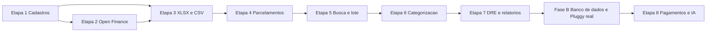

# Agente de Bolso: acompanhamento do projeto

**Para quem é**: o dono do negócio (Matheus) e quem acompanha o produto sem precisar ler código.
**Como funciona**: este documento é atualizado a cada marco. A última atualização está no [histórico](#9-histórico-de-atualizações), no fim.
**Última atualização**: 06/10/2026 (tarde)

---

## 1. Como ler este documento

Cada item traz uma etiqueta que diz em que pé ele está:

| Etiqueta | Significa |
|---|---|
| **[Pronto]** | Existe, foi testado e está descrito nos manuais |
| **[Pronto, aguardando aprovação]** | Está construído e testado, mas ainda não entrou na versão principal |
| **[Decidido]** | Você decidiu; falta construir |
| **[Proposta]** | Sugestão minha, que **ainda não foi aprovada**. Pode mudar |
| **[A definir]** | Falta uma decisão ou uma informação |

**Regra do projeto**, como você pediu: nada é construído isolado. Banco de dados, auditoria, permissões, idempotência (repetir sem duplicar), origem do dado e a possibilidade de desfazer ou corrigir fazem parte de cada funcionalidade desde o começo. A auditoria, as baixas e a separação de funções que já existem não são substituídas nem simplificadas.

**Não há telas nesta fase.** A entrega é o serviço (API), com a documentação técnica que descreve cada operação. As telas e os canais usam essa API depois.

---

## 2. Situação em uma página

| Etapa | O que é | Situação |
|---|---|---|
| **Já construído** | Fluxo de caixa, conciliação do extrato (arquivo OFX) e controles de segurança, guardados **em memória** | **[Pronto]** (seção 3) |
| **0** | Banco de dados e infraestrutura | **Adiada para a Fase B**: as funcionalidades vêm primeiro, com os dados em memória (ver o aviso abaixo) |
| **1** | Centro de custo, forma de pagamento e titularidade da conta | **[Pronto]** (U4) |
| **2** | Open Finance (Pluggy) e atualização automática | **[Pronto com banco simulado]** (U5, U5b): porta do agregador, adaptador de teste e estorno automático; a Pluggy real vem no fim, com o banco de dados |
| **3** | Importação de XLSX e CSV (extrato e lançamentos), com duplicidade entre origens | **[Pronto]** (U6, U7) |
| **4** | Parcelamentos e repetições | **[Pronto]** (U8) |
| **5** | Busca, edição em massa, seleção acumulada, totalizador e exportação | **[Em construção]**: busca, seleção e totalizador (U9) aprovados; massa (U10) e exportação (U11) a fazer |
| **6** | Categorização por histórico e nota de confiança | **[Decidido]** |
| **7** | DRE configurável, previsto contra realizado e relatórios gerenciais | **[Decidido]** |
| **8** | Pagamentos pelo banco e IA externa | Fase futura, só documentada |

*Versão em texto: cada etapa depende da anterior, e a Etapa 3 depende também da 2. O banco de dados (Etapa 0, na Fase B) e a conexão real com a Pluggy vêm depois da Etapa 7 e antes da Etapa 8.*

> **Mudança de ordem (06/10/2026)**: você tinha aprovado o banco de dados como primeira etapa. Decidimos construir **primeiro as funcionalidades das Etapas 1 a 7, com os dados em memória**, e fazer o banco de dados depois, para fechar a primeira fase com o que você já respondeu. Isso **não** refaz regra de negócio: o banco entra no lugar da memória, e os mesmos testes provam que o comportamento é igual. O que muda para você: **nada vai a um cliente real antes do banco de dados**, e a Pluggy real (que precisa guardar credenciais e histórico) só entra na Fase B. Está como pergunta para a sua confirmação no [resumo e perguntas](../brainstorming/Matheus%20dia%2002/RESUMO-E-PERGUNTAS-PARA-O-MATHEUS-2026-10-06.md).

**Dois limites que valem para tudo**
- Hoje o sistema **ainda não guarda dados entre execuções** (o banco de dados, na Fase B, resolve isso) e **não passou por teste de intrusão** (o pentest, planejado antes do primeiro cliente real). Nenhuma funcionalidade chega a um cliente antes dessas duas coisas.
- **Não há datas.** Elas saem quando o escopo das Etapas 1 a 7 estiver detalhado e for possível estimar.

---

## 3. O que já está pronto

Para o passo a passo de cada operação, veja o [Guia Rápido](GUIA-RAPIDO.md), o [Manual do Fluxo de Caixa](MANUAL-FLUXO-DE-CAIXA.md), o [Manual da Conciliação Bancária](MANUAL-CONCILIACAO-BANCARIA.md) e as [Regras de Negócio](../sdd/REGRAS-DE-NEGOCIO.md). Aqui vai o resumo.

### Fluxo de caixa **[Pronto]**
- **Categorias, contas financeiras e lançamentos** com as três datas (vencimento, competência e liquidação). A situação do lançamento (previsto, parcial, pago, vencido, cancelado) é **calculada**, nunca digitada.
- **Baixas** totais ou parciais, com a diferença de liquidação (juros, multa, desconto) calculada. Uma baixa **nunca é editada**: para corrigir, estorna-se e lança-se a certa.
- **Transferências entre contas próprias**, estornos, cancelamento, saldo por conta e projeção de caixa.
- **Quem pode**: o Admin escreve (com autenticação forte nas ações críticas); os demais papéis consultam.

### Conciliação bancária **[Pronto]**
- **Conta bancária e importação do extrato OFX**: o número da agência e da conta **nunca é guardado**, só um código de reconhecimento e os 4 últimos dígitos. Reimportar o mesmo arquivo não duplica.
- **Conferência de saldo** em três estados (conferido, sem conferência, divergente).
- **Sugestões, exceções e confirmação**: o sistema sugere; só liga sozinho com prova exata; **dois candidatos nunca viram ligação automática**. Confirmar em lote, rejeitar, desfazer (sempre com histórico), ignorar e reativar.
- **Transferência interna e par de estorno**: o sistema sugere o par entre contas e mostra as transferências sem contrapartida.
- **Regras de reconhecimento** (o Admin cadastra) e **sugestão de categoria** que aprende com a sua escolha, sem nunca criar lançamento sozinha.
- **CPF e CNPJ** aparecem sempre mascarados, inclusive dentro da descrição.

### Baixa que já existe **[Pronto, aguardando merge da branch `baixa-existente`]**
Se o pagamento já foi registrado à mão e o extrato chega depois, o sistema **liga a transação à baixa existente**: não cria outra baixa, não cria outro lançamento e não duplica o saldo.
- Só **sugere**; uma pessoa confirma.
- O valor precisa ser **exatamente igual**.
- Desfazer a ligação **não estorna a baixa**.
- Criar um lançamento novo para essa transação exige um **motivo**.
- Detalhes na [regra de negócio 4.11](../sdd/REGRAS-DE-NEGOCIO.md) e na [decisão técnica](../adr/014-vinculo-a-baixa-existente.md).

### Controles de segurança e confiança **[Pronto]**
- **Auditoria em cadeia**: qualquer alteração no histórico é detectável.
- **Separação de funções**: com 2 ou mais Admins, quem propõe não confirma; com 1, a aprovação própria fica marcada e vai para um relatório.
- Cada empresa vê só os seus dados; logs e métricas sem dado pessoal; varredura automática de vulnerabilidades em cada alteração.
- O quadro completo, com o que ainda falta, está em [Segurança e Privacidade](SEGURANCA.md).

---

## 4. Etapa 0: banco de dados e infraestrutura (adiada para a Fase B)

*Continua descrita aqui porque é pré-requisito de qualquer cliente real. Foi adiada por decisão de 06/10/2026 (ver o aviso na seção 2).*

| Tópico | Detalhe |
|---|---|
| **Para quê** | O sistema passa a **guardar os dados com segurança**. Reiniciar não perde nada. É pré-requisito de todas as outras etapas |
| **Funcionalidades** | Lançamentos, baixas, transações, ligações, auditoria e usuários guardados em banco. Cada empresa isolada também no banco. Cópia de segurança e restauração |
| **Regras de negócio** | Nada se apaga: o histórico (baixas, ligações, auditoria) só cresce. A repetição de uma operação não duplica nada. O número da conta bancária continua **nunca guardado** |
| **Quem usa** | Ninguém diretamente: não muda nenhuma operação, muda **onde** os dados ficam |
| **Dados guardados** | Tudo o que hoje fica em memória, mais a data de retenção de cada classe de dado |
| **Auditoria** | A cadeia de auditoria continua verificável depois da migração |
| **Critérios de aceite** | Os dados sobrevivem a um reinício. O comportamento é o **mesmo** de hoje (os testes rodam contra a memória e contra o banco). Uma empresa não enxerga a outra no banco. O histórico não pode ser alterado nem excluído. Teste de carga contra o banco dentro das metas já definidas (consultas com 50 mil transações em até 0,5 s para 95% das chamadas) |
| **Dependências** | Nenhuma. As demais etapas dependem desta |
| **Eliminação de dados pessoais** | **[Proposta]** 5 anos para registros contábeis e trilha; descrição e arquivo do extrato, 5 anos ou a política da empresa; depois, anonimização (a transação fica, o texto livre sai). **[A definir]** com o jurídico e o contador |
| **Ordem de migração** | **[Proposta]** primeiro a plataforma (auditoria, segurança), depois o fluxo de caixa, depois a conciliação, uma entrega para cada |
| **Metas de recuperação** | **[Decidido]** perda de dados de no máximo 15 minutos, retorno em até 4 horas, disponibilidade de 99,5% ao mês (valem na fase da nuvem) |
| **A definir** | Onde roda em produção (nuvem), definido no desenho da infraestrutura |

---

## 5. Etapa 1: centro de custo e forma de pagamento

| Tópico | Centro de custo | Forma de pagamento |
|---|---|---|
| **Para quê** | Dizer **para quem ou onde** o gasto aconteceu (a categoria diz com o quê) | Dizer **como** foi pago |
| **O que o usuário informa** | Nome do centro de custo | Nome da forma de pagamento |
| **Funcionalidades** | **[Decidido]** cadastro por empresa: criar, editar e inativar. Um por lançamento, **opcional**. Disponível em filtros, relatórios, DRE, importação e edição em massa. **Sem rateio** na primeira versão | **[Decidido]** cadastro por empresa: criar, editar, inativar e reativar. Opções iniciais: Pix, boleto, TED, cartão de crédito, cartão de débito, dinheiro e débito automático. Disponível na importação, filtros, lançamentos e edição em massa |
| **Regras de negócio** | **[Proposta]** inativar não muda o histórico: lançamentos antigos continuam mostrando o centro. Um centro inativo não pode ser escolhido em lançamentos novos | **[Proposta]** as 7 opções são criadas para cada empresa nova; inativar uma opção não afeta lançamentos antigos |
| **Quem pode** | **[Proposta]** o Admin cadastra e altera; todos os papéis consultam | **[Proposta]** igual |
| **Validações** | **[Proposta]** nome obrigatório, sem repetição na mesma empresa | **[Proposta]** igual |
| **Como desfazer ou corrigir** | **[Proposta]** inativar e reativar; renomear. Nada é apagado | **[Proposta]** igual |
| **Auditoria** | **[Proposta]** criação, renomeação, inativação, reativação e troca do centro de um lançamento, com quem, quando e o antes e o depois | **[Proposta]** igual |
| **Dados guardados** | **[Proposta]** empresa, nome, ativo ou inativo, datas; no lançamento, a referência ao centro | **[Proposta]** igual |
| **Critérios de aceite** | **[Proposta]** lançamento sem centro continua funcionando; o filtro por centro devolve só os lançamentos dele; centro inativo não aparece para escolha mas aparece no histórico; uma empresa não vê os centros de outra | **[Proposta]** igual, e as 7 opções existem em toda empresa nova |
| **Dependências** | Nenhuma nesta fase (dados em memória) | Nenhuma nesta fase |

As regras que aprendem (Etapa 6) passam a sugerir **categoria, centro de custo e forma de pagamento** juntos **[Decidido]**.

### Titularidade da conta (PJ ou PF) e visibilidade, parte da Etapa 1 **[Decidido, detalhado em 06/10/2026]**

| Tópico | Como vai funcionar |
|---|---|
| **Para quê** | Separar o que é da empresa do que é pessoal dos sócios. Saldos, projeção, DRE e relatórios da empresa mostram **só as contas da empresa (PJ)**; as contas pessoais (PF) só entram quando alguém autorizado pede |
| **O que o usuário informa** | Ao cadastrar uma conta, se ela é da **empresa (PJ)** ou **pessoal (PF)**. É obrigatório; o sistema nunca escolhe sozinho |
| **Corrigir um erro de cadastro** | O Admin corrige a titularidade **enquanto a conta não tiver nenhum movimento** (baixa, estorno, transferência, extrato importado ou saldo conferido), com confirmação extra e motivo, e fica registrado o antes e o depois. Depois do primeiro movimento a titularidade fica fixa; o caminho é inativar a conta e cadastrar outra. Motivo: mudar a titularidade de uma conta com movimento reescreveria o passado dos relatórios |
| **Dinheiro entre conta da empresa e conta de sócio** | **Não é transferência interna.** O sistema recusa registrar assim e coloca o movimento na lista de pendências com o motivo "movimento entre titularidades", para um humano classificar e para o contador definir como tratar (aporte, retirada, empréstimo). **Nenhuma categoria é sugerida** até o contador decidir |
| **Quem vê as contas pessoais** | **[Proposta]** só o Admin. Se uma despesa da empresa foi paga por uma conta pessoal, **todos** os que podem ver lançamentos veem que ela foi paga, na data e no valor corretos, e os totais da empresa batem; a conta aparece como "conta restrita", sem nome, saldo nem extrato. Extrato e transações da conta pessoal ficam ocultos por inteiro para quem não pode ver |
| **Como desfazer ou corrigir** | Cadastro de centro de custo e forma de pagamento: inativar e reativar, nunca apagar. Titularidade: ver acima |
| **O que fica registrado** | Quem fez, quando e o motivo, em toda criação, troca e correção |
| **Critérios de aceite** | Conta sem titularidade é recusada; saldo padrão soma só contas PJ e informa que não incluiu PF; correção só sem movimento e só com confirmação extra; transferência PJ↔PF é recusada e vai para pendências; quem não pode ver contas PF vê o lançamento pago, com a conta como "conta restrita" |
| **A definir com você** | **Quem, além do Admin, pode ver as contas pessoais** (pergunta já enviada). **Com o contador**: como classificar aporte, retirada e empréstimo, e como registrar que a empresa passa a dever ao sócio quando uma conta pessoal paga uma despesa da empresa. O sistema ainda não tem esse registro de dívida |

---

## 6. Etapa 2: Open Finance (Pluggy) e atualização automática

| Tópico | Detalhe |
|---|---|
| **Para quê** | As movimentações e o saldo chegam sozinhos, sem baixar e enviar arquivo |
| **O que o usuário informa** | Autoriza o acesso de leitura ao banco; escolhe a conta do sistema que corresponde a cada conta do banco |
| **Funcionalidades** | **[Decidido]** conectar pela Pluggy, de forma **genérica** (Inter, Itaú, Bradesco, Sicredi, Sicoob, Nubank, Santander e Caixa, contas PF e PJ). Atualização automática **várias vezes ao dia**, mais "Atualizar agora" com proteção contra repetição. Reconectar quando houver problema. Desconectar (os dados já importados ficam pelo prazo de guarda) |
| **O que o sistema registra a cada atualização** | **[Decidido]** última sincronização, situação da conexão, erro da última, período consultado e quantidade de movimentações novas. Ao final, mostra **"Confere"** ou **"Diverge"** com o valor da diferença |
| **Regras de negócio** | Só entra a movimentação já efetivada. Repetir a mesma atualização não duplica nada. Se o arquivo OFX do mesmo período também for importado, não há duplicidade. Falha no meio **não grava nada pela metade** e a conexão fica "com erro". A importação por arquivo continua funcionando se a conexão parar. Acesso **somente leitura**: nunca pede permissão de pagamento. Regras completas em [Conexão Bancária](../sdd/rules/REGRAS-CONEXAO-BANCARIA.md) |
| **Contas PF e PJ** | **[Decidido · fechado com as normas em 06/10/2026]** na mesma empresa, cada conta com sua **titularidade** (PJ ou PF), que não muda depois do primeiro movimento. **DRE e DFC usam sempre só as contas PJ** (Princípio da Entidade; Código Civil art. 49-A). Saldos, projeção e indicadores de caixa consideram só PJ por padrão; as PF entram por filtro, como "visão do caixa do dono", sempre identificada. Dinheiro entre PJ e PF não é transferência: uma pessoa escolhe o tipo — pró-labore (despesa), distribuição de lucros, aporte, empréstimo do sócio ou reembolso (fora da DRE, financiamento). Despesa da empresa paga pela PF gera obrigação de reembolso ao sócio; o reembolso não é segunda despesa. Movimento sem tipo fica na fila, fora da DRE. Regras: FC-14 a FC-18 (RULES-FC 2.3.0), manifesto complementar MC1 (manifesto vigente 2.1.2 inalterado), D-38 a D-43. **Em aberto:** Matheus concordar (pergunta 2) e dizer o prazo para classificar (FQ-10); efeitos fiscais com o contador. |
| **Quem pode** | **[Decidido · U5]** o Admin, com MFA, conecta, confirma, reconecta e desconecta; Admin e Operador usam "Atualizar agora"; todos consultam a situação da conexão. Conexão de conta pessoal (PF) só aparece para quem vê contas PF (hoje, só o Admin) |
| **Situações da conexão** | **[Decidido · U5]** aguardando autorização, rejeitada, ativa, com erro, expirada, revogada e desconectada. A conexão aparece **expirada** sozinha quando a validade do consentimento passa (no máximo 12 meses, pela norma do Banco Central). Rejeitada e desconectada não voltam: é preciso uma conexão nova. Uma conexão não mistura contas da empresa com contas pessoais |
| **O que "Atualizar agora" faz** | **[Decidido · U5]** busca as movimentações de cada conta da conexão, do último corte até agora. Se pedido de novo em pouco tempo, ou se o limite de chamadas do dia ou do mês acabou, mostra a última atualização, sem nova consulta ao banco (protege o custo do agregador) |
| **Revisões e cancelamentos pelo banco** | **[Decidido · U5]** se o banco altera ou cancela uma movimentação já registrada, nada muda sozinho: ela vai para a fila de pendências com o motivo, para uma pessoa decidir. O estorno automático fica para uma etapa própria (U5b), antes da Pluggy real |
| **Dados guardados** | Conexão, consentimento (data, escopo, validade), contas conectadas, histórico de atualizações. As credenciais ficam **cifradas e separadas** dos dados financeiros |
| **Auditoria** | Toda mudança de situação da conexão fica registrada (data, situação anterior, nova e motivo) |
| **Critérios de aceite** | O pedido de consentimento não traz nenhuma permissão de pagamento. Conexão vencida ou revogada é percebida na atualização seguinte, os dados ficam e a importação por arquivo continua. Nenhum teste do núcleo muda ao trocar de agregador. Nenhuma divergência de saldo falsa por causa de movimentação pendente |
| **Dependências** | Etapa 1 |
| **Nesta fase (sem banco)** | Só a **porta do agregador** e um **adaptador de teste** que simula o banco. Isso prova a duplicidade entre origens, a conferência de saldo e a repetição sem duplicar, sem credenciais. A conexão real, com credenciais e histórico guardados, vem na Fase B |
| **A definir** | Quais 2 ou 3 bancos nos testes práticos; **intervalo mínimo** do "Atualizar agora", **limite de chamadas** por conexão (dia e mês, conferir no contrato da Pluggy) e **dias de sobreposição** entre uma atualização e a seguinte (sem esses números, o sistema não sobe em produção); texto de consentimento e prazo de guarda após desconexão (jurídico); quem vê as contas PF; como tratar o dinheiro entre conta PF e conta PJ (não é transferência neutra: é retirada ou aporte do sócio) |

---

## 7. Etapa 3: importação de XLSX e CSV, com duplicidade entre origens

| Tópico | Detalhe |
|---|---|
| **Para quê** | Aceitar planilhas de layouts diferentes, tanto de **extrato** quanto de **lançamentos** |
| **O que o usuário informa** | O arquivo; a ligação entre as colunas da planilha e os campos do sistema; a confirmação do formato de data e de decimal |
| **Funcionalidades** | **[Decidido]** dois destinos com o mesmo mapeador de colunas: **extrato** vai para a conciliação, **lançamentos** vão para o fluxo de caixa. Prévia antes de importar. Reconhecimento de data e decimal. **Memória do layout** por banco ou modelo. Lote com aceitas, em revisão e recusadas, e **desfazer o lote inteiro** sem apagar o histórico. Começa pelo extrato |
| **Lançamentos importados** | **[Decidido]** passam por **revisão antes de gravar**. Um registro "já pago" cria o lançamento **e a baixa** (nunca só um status). Se a transação do banco chegar depois, liga-se à baixa existente |
| **Duplicidade** | **[Decidido · U6]** vale para **qualquer** origem (OFX, planilha, conexão, API): a mesma data, valor e sentido, na mesma posição entre as iguais, **sem olhar a descrição**. As duas transações ficam, a mais nova vai para a fila como "possível duplicidade" e o motor não concilia nenhuma até alguém decidir: **manter as duas** ou **descartar uma** (fica marcada como descartada, ligada à que ficou). Só se descarta uma que não esteja conciliada. Sempre com motivo. **Nunca excluídas automaticamente** |
| **Regras de negócio** | **[Proposta]** na primeira vez que um layout é usado, o usuário confirma data e decimal (03/04 pode ser 3 de abril ou 4 de março). Planilha sem saldo deixa a conferência de saldo "sem conferência". **[Proposta]** "já pago" sem conta ou data de pagamento na planilha entra como previsto e vai para revisão |
| **Quem pode** | **[Decidido · U6]** Admin e Operador enviam, mapeiam, revisam e confirmam; **desfazer o lote** e **decidir duplicidade** são do Admin, com MFA e a segregação da empresa. Conta pessoal (PF) só para quem vê contas PF |
| **Como desfazer ou corrigir** | **[Decidido · U6]** o lote é desfeito **inteiro**: as conciliações das transações dele são estornadas, as baixas que essas conciliações geraram também, e as transações passam a "desfeitas" (não voltam). Baixa feita à mão e baixa que já existia **não são tocadas**. Antes de confirmar, o sistema mostra o que será estornado e a pessoa **digita o número de transações** que serão desfeitas. Se qualquer estorno for recusado, **nada** é desfeito. Mês com DRE emitida ou exportação ao contador bloqueia (até reabrir). Não existe desfazer o desfazer: para voltar, importa o arquivo de novo. Há também o atalho "desfazer e reimportar em outra conta". Nada é apagado; exige MFA e segue a regra de segregação da empresa |
| **O lote na tela (U6)** | **[Decidido · U6]** cada linha da planilha cai em um grupo: **aceita**, **em revisão** (valor zero, descrição vazia, repetida no próprio lote, data muito fora das demais: a pessoa decide) ou **recusada** com o motivo (data ou valor ilegíveis, mais de duas casas decimais, débito e crédito juntos, linha de total, e **data futura ou agendada**, que nunca vira movimentação). Só se confirma quando nada resta em revisão |
| **Valor e sentido (U6)** | **[Decidido · U6]** a planilha pode trazer o valor com sinal, ou colunas de débito e crédito, ou valor positivo mais uma coluna de tipo. Nunca arredonda: mais de duas casas é recusado |
| **Layout lembrado (U6)** | **[Decidido · U6]** reconhecido pelos nomes das colunas (não pela ordem nem pela caixa); a pessoa dá um nome e o formato de data e decimal é confirmado só na primeira vez, a menos que a amostra nova contradiga. Layout se arquiva, não se apaga |
| **Segurança** | **[Decidido · U6]** arquivo de até 10 MB e 5.000 linhas (quem tem mais divide por período); só `.xlsx` e `.csv`, reconhecidos pelo conteúdo; **fórmulas nunca são executadas**; arquivo com macro, criptografado, com partes repetidas ou que "incha" demais ao abrir é recusado, sem gravar nada; no máximo 4 arquivos lidos ao mesmo tempo; valor com mais de duas casas é recusado, nunca arredondado; CPF e CNPJ mascarados |
| **Dados guardados** | Arquivo original, lote, cada linha com sua origem, memória de layout por empresa |
| **Auditoria** | Importação, revisão, confirmação e desfazer do lote, com quem e quando |
| **Critérios de aceite** | Reimportar o mesmo arquivo não duplica. Uma transação que chega depois de um lançamento "já pago" **nunca** gera segunda baixa nem saldo duplicado (teste obrigatório). A prévia mostra os erros antes de gravar |
| **Dependências** | Etapas 1 e 2 |
| **A definir** | Layouts reais (exemplos de OFX, XLSX e CSV de 2 bancos, sem dados pessoais) |

---

## 8. Etapas 4 a 8

| Etapa | Funcionalidades | Regras já decididas | Dependências | A definir |
|---|---|---|---|---|
| **4. Parcelamentos e repetições** | Repetir mensalmente ou parcelar em N vezes (ex.: 12 parcelas de R$ 1.000,00). Editar **só uma parcela ou a sequência** **[Decidido]** | **[Proposta]** parcelas já baixadas não mudam ao editar a sequência | 1 | Regra de edição de parcelas baixadas |
| **5. Busca, lote, seleção e exportação** | Busca global; edição em massa; **"Dar baixa nos selecionados"** (conta, data, valor e confirmação; cada lançamento recebe a sua baixa; prévia e resultado item a item); seleção acumulada; totalizador de entradas, saídas e líquido; exportação para Excel **respeitando os filtros** **[Decidido]** | O status "Pago" nunca é editado, só se dá baixa. A baixa em massa segue o modo de separação de funções da empresa. **[Proposta]** a exportação respeita papéis e mascara CPF e CNPJ, e fica auditada | 1 e 3 | Sem telas: tudo disponível como operação da API |
| **6. Categorização e nota de confiança** | Sugestão de categoria, centro de custo e forma de pagamento pelo histórico e pelas regras aprendidas; **nota de confiança** para encontrar, ordenar e explicar correspondências **[Decidido]** | A nota **não confirma sozinha**: a confirmação é humana, salvo prova exata. Automação por nível de confiança, por empresa: futuro | 1 e 3 | |
| **7. DRE e relatórios** | **DRE configurável**: a categoria é uma coisa e a estrutura da DRE é outra (agrupamento gerencial), com **versões por data de vigência**. Previsto contra realizado. Relatórios gerenciais **[Decidido]** | Por padrão, só contas PJ | 1 e 6 | **Lista dos relatórios gerenciais** (quais são os 3 primeiros); estrutura da DRE validada pelo contador |
| **8. Pagamentos e IA externa** | **Fase futura**, só documentada. Pagamento pelo banco com **três status separados**: ordem bancária, financeiro e conciliação. A conciliação só acontece quando a movimentação aparece no extrato. IA externa só depois de LGPD e segurança | Autorização, idempotência e prevenção de pagamento duplicado são da fase própria | Todas as anteriores | O que existe hoje no projeto do Inter Empresas |

---

## 9. Histórico de atualizações

Cada marco acrescenta uma linha aqui, com a data e o que mudou.

| Data | O que mudou |
|---|---|
| 09/10/2026 (fim do dia) | **Etapa 2 detalhada, parte 2** (U5b): quando o banco (pela conexão) muda ou cancela uma transação já registrada, a versão nova é guardada sem apagar a antiga, a conciliação feita com o dado antigo é estornada pelo sistema e abre aviso para conferência; o saldo da conta volta a ser conferível na importação seguinte. Decidido: o banco de dados PostgreSQL fica por último, depois de fechar o ciclo 2. Histórias US-130 a US-136 |
| 09/10/2026 (noite) | **U5b construída**: versões da transação, estorno pelo sistema quando o banco muda ou cancela, "conferi a revisão", saldo que volta a ser conferível e registro dos meses fechados mexidos. Três consultas novas na API. Todos os testes passando (3.012 na aplicação). Aguardando aprovação |
| 10/10/2026 | **U5b aprovada** e testada: código aprovado; build completo verde; resumo dos testes mostra o que cada regra garante. Ressalva: teste ponta a ponta pela API quando a Pluggy real entrar |
| 10/10/2026 (tarde) | **U7 construída**: importar contas a pagar e a receber por planilha. Linha com data de pagamento entra já paga e, quando o extrato chega, liga na mesma baixa (testado de ponta a ponta); cadastros pelo nome, com memória, sem criar cadastro; recusados na gravação voltam para revisão; desfazer o lote inteiro, bloqueado se alguma baixa já estiver conciliada. Aguardando aprovação |
| 10/10/2026 (fim da tarde) | **U7 aprovada e testada** (3.016 testes na aplicação). Com ela fecham U5, U5b, U6 e U7. Próximo: U8 (parcelas e séries) |
| 10/10/2026 (noite) | **Etapa 4 detalhada** (U8): parcelar uma compra em até 60 vezes ou repetir uma conta todo mês, com prévia; o centavo que sobra fica na última parcela; a competência segue a regra contábil (compra parcelada no mês da compra, aluguel mês a mês); editar uma parcela ou as próximas sem mexer nas já pagas; encerrar com MFA e segregação. Pergunta dos juros embutidos enviada ao contador (Q-20). Histórias US-137 a US-144 |
| 10/10/2026 (noite) | **U8 construída**: parcelar e repetir pela API, com prévia; editar "esta e as próximas" sem mexer nas já pagas; estender a repetição; encerrar com MFA e segregação. Criado o documento da arquitetura de serviços (TOGAF), ligado ao README. Aguardando aprovação |
| 10/10/2026 (16:15) | **U8 código aprovado** e testado: build completo verde (3.019 testes na aplicação). Aguardando aprovação do Build and Test |
| 10/10/2026 (tarde) | **U8 aprovada**. Próximo: U9 (busca, seleção e totalizador) |
| 10/10/2026 (noite) | **Etapa 5 detalhada, parte 1** (U9): buscar lançamentos e transações por texto, valor, CPF/CNPJ ou identificador; somar o que foi selecionado (previsto, pago, em aberto); conta pessoal continua protegida. Decidido aceitar o CNPJ novo com letras (D-49). Histórias US-145 a US-151 |
| 10/10/2026 (noite) | **U9 desenho aprovado**: metas de tempo da busca e do totalizador, limites contra robôs que tentam descobrir clientes e fornecedores pela busca, e a busca por CPF ou CNPJ auditada. Desenho técnico aguardando aprovação. Quadros de situação deste documento, do README e do plano de unidades atualizados |
| 11/10/2026 | **U9 construída**: busca e totalizador de lançamentos e de transações pela API; CNPJ novo com letras aceito; busca por CPF/CNPJ limitada e auditada; conta pessoal continua protegida. Corrigida uma brecha antiga: quem não vê contas pessoais conseguia listar lançamentos filtrando pelo id de uma delas. Aguardando aprovação |
| 11/10/2026 (noite) | **Manuais atualizados com o ciclo 2** (U4 a U9): fluxo de caixa (jornadas 10 a 14), conciliação (jornadas 7 a 12), índice, guia rápido, manual técnico (rotas novas e limites), segurança e decisões. Links internos dos manuais corrigidos |
| 11/10/2026 (noite) | **U9 aprovada**. Decidido montar um pacote de validação para o Matheus e os sócios irem validando (roteiro, lista de aceite, demonstração com dados fictícios). Próximo: U10 |
| 09/10/2026 (noite) | **Etapa 3 detalhada, parte 2** (U7): importar contas a pagar e a receber por planilha. Linha com data de pagamento entra já paga (sem segunda baixa quando o extrato chegar); categoria e conta reconhecidas pelo nome, com memória, sem criar cadastro; competência pela coluna ou pelo mês do lote (nunca copiada do vencimento); possíveis duplicidades lado a lado; o Operador prepara e o Admin confirma. Histórias US-121 a US-129 |
| 09/10/2026 (tarde) | **Correção e decisão** (U6): planilha reenviada com o mesmo identificador e valor diferente agora entra como movimentação nova com aviso, e não mais como "revisão do banco" (regras CB-19 e CB-22); a revisão pelo banco vale só para a conexão bancária. **Decidido** manter o OFX onde está, na conciliação, com os motivos e os gatilhos para rever na ADR 015 |
| 09/10/2026 | **Etapa 3 construída** (U6): importação de planilha XLSX e CSV pela API (prévia, mapeamento, layout lembrado, revisão, confirmação), duplicidade entre origens e desfazer o lote inteiro com as travas. Aguardando aprovação do código | 
| 08/10/2026 (madrugada) | **Etapa 3 em construção** (U6): pronta a leitura de planilha XLSX e CSV (tipo pelo conteúdo, fórmula nunca calculada, recusa de arquivo malicioso, limites, datas do Excel e valores sem arredondar), a detecção de duplicidade entre origens e o motor de desfazer lote. Falta o fluxo completo pela API (prévia, mapeador, layout, revisão, confirmação, desfazer). Lista de funcionalidades atualizada |
| 08/10/2026 (noite) | **Etapa 3 detalhada** (U6): planilha XLSX e CSV com prévia, três jeitos de informar valor e sentido, layout lembrado, grupos aceita, em revisão e recusada, duplicidade entre qualquer origem, desfazer o lote inteiro com estorno. Histórias US-110 a US-120 |
| 08/10/2026 (tarde) | **Etapa 2 construída com o banco simulado** (U5): entrada de movimentações sem arquivo, conexão, "Atualizar agora", reconectar, desconectar e revisões do banco na fila já funcionam pela API, contra um banco de teste. A Pluggy real entra na Fase B |
| 08/10/2026 | **Etapa 2 detalhada** (U5): entrada de movimentações sem arquivo pelo mesmo caminho do OFX, situações da conexão, "Atualizar agora" com intervalo e limite de chamadas, reconectar sem buraco no extrato, desconectar sem apagar, revisões e cancelamentos do banco na fila. Histórias US-100 a US-109. Banco simulado nesta fase; Pluggy real na Fase B |
| 06/10/2026 (noite) | **DRE (Etapa 7) com regras e normas**: `REGRAS-DRE.md`, Manifesto Complementar 03 e guia de boas práticas da DRE em `sdd/rules`. DRE gerencial com as linhas mínimas da NBC TG 1002, despesas por função, DAS em dedução; validado com o caderno e o texto oficial (D-44 a D-48). Pendências DQ-01 a DQ-08 com contador e Matheus |
| 06/10/2026 (noite) | **Contas PF e PJ fechado com as normas**: lista fechada de tipos de movimento entre empresa e sócio, reembolso ao sócio sem segunda despesa, movimento sem tipo fora da DRE (RULES-FC 2.3.0, manifesto 2.2.0, D-40 a D-43). Manifestos complementares criados: MC1 (entidade e sócios) e MC2 (boas práticas); o manifesto vigente 2.1.2 não é alterado |
| 06/10/2026 | **Etapa 1 detalhada** (U4): centro de custo, forma de pagamento, titularidade PJ ou PF, correção só sem movimento, recusa de transferência entre conta da empresa e conta pessoal, visibilidade das contas pessoais. Histórias US-093 a US-099 |
| 06/10/2026 (tarde) | **Mudança de ordem**: o banco de dados (Etapa 0) foi adiado para a Fase B; as Etapas 1 a 7 serão construídas primeiro, em memória. A Etapa 2 passa a ter, nesta fase, só a porta do agregador e um adaptador de teste. Dependências ajustadas. Pergunta de confirmação enviada ao Matheus |
| 06/10/2026 | Primeira versão. Inclui o que já está pronto, a ligação à baixa existente (pronta, aguardando aprovação), o detalhamento das Etapas 0 a 3 e as Etapas 4 a 8 em resumo. A Etapa 0 está em planejamento |

---

## 10. Para saber mais

| Assunto | Documento |
|---|---|
| Passo a passo das operações | [Guia Rápido](GUIA-RAPIDO.md), [Fluxo de Caixa](MANUAL-FLUXO-DE-CAIXA.md), [Conciliação Bancária](MANUAL-CONCILIACAO-BANCARIA.md) |
| Regras de negócio | [Regras de Negócio](../sdd/REGRAS-DE-NEGOCIO.md) |
| Decisões já tomadas | [Decisões do Projeto](DECISOES-DO-PROJETO.md) |
| Segurança, LGPD e pentest | [Segurança e Privacidade](SEGURANCA.md) |
| Conexão bancária (Open Finance) | [Spec](../sdd/specs/002-conexao-bancaria/spec.md) e [regras](../sdd/rules/REGRAS-CONEXAO-BANCARIA.md) |
