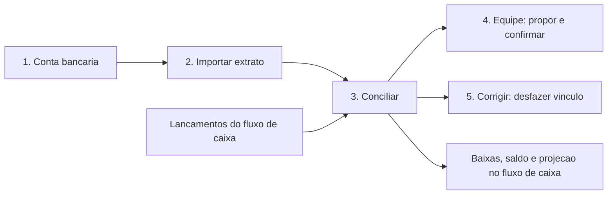
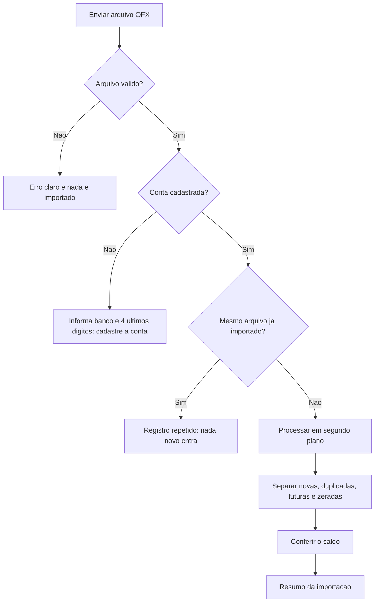
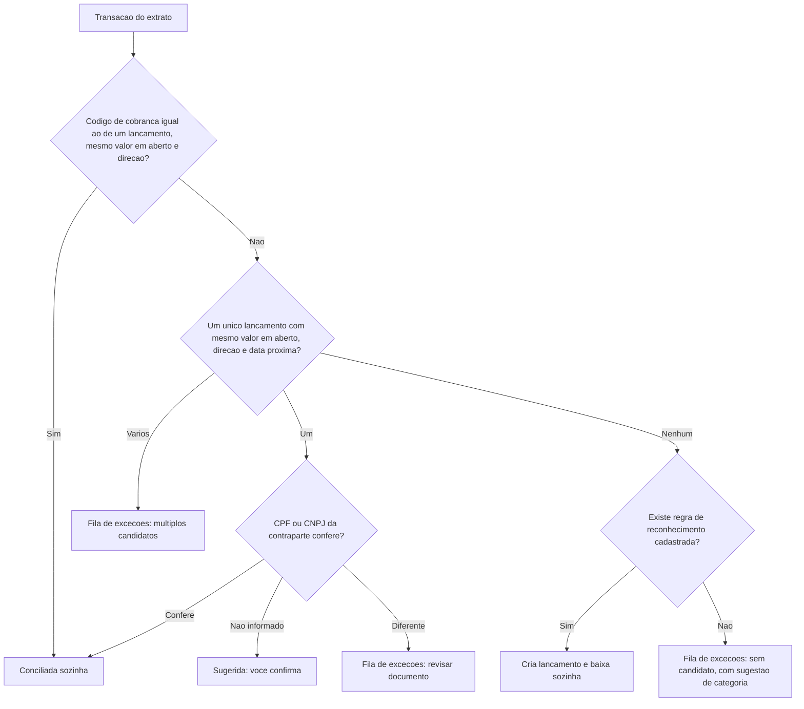
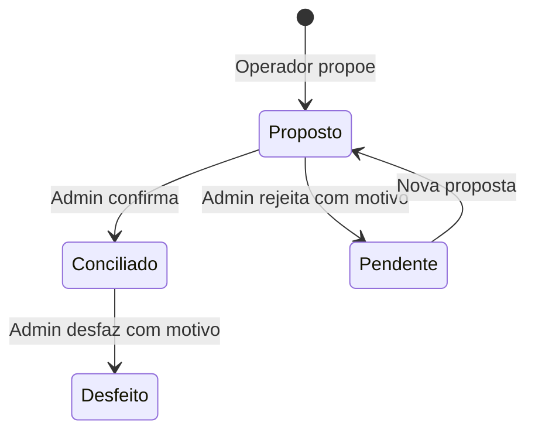
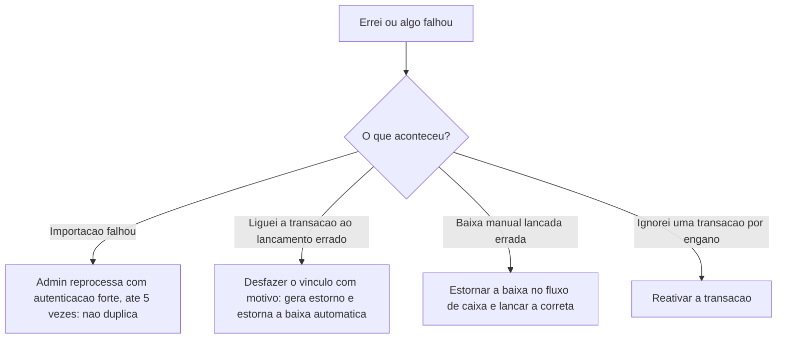

# Manual do Usuário — Conciliação Bancária

**Versão**: 2.0 · **Data**: 2026-10-11 · **Produto**: Agente de Bolso
**Para quem**: sócios, assistentes administrativos, consultores de BPO e contadores que importam o extrato do banco e conferem com o que foi lançado. Não é preciso conhecer tecnologia.
**Manual irmão**: [Fluxo de Caixa](MANUAL-FLUXO-DE-CAIXA.md) (lançamentos, baixas, saldo e projeção). Quem é quem e a autenticação forte estão no [índice dos manuais](MANUAL-DO-USUARIO.md).

## O que a conciliação faz

Traz o **extrato do banco**, garante que **nada é duplicado**, confere o **saldo**, e **liga cada transação do banco ao lançamento** que a explica. O que o produto tem certeza ele liga sozinho; no resto, pede a sua decisão. Nada é apagado.

**Pré-requisito**: ter lançamentos registrados no [fluxo de caixa](MANUAL-FLUXO-DE-CAIXA.md). Sem eles, tudo vira "pendência" e você cria os lançamentos a partir do extrato.

Cada jornada traz um selo:

| Selo | Significado |
|---|---|
| **[Disponível]** | Já funciona hoje |
| **[Em construção]** | Aprovado e em desenvolvimento (nenhuma jornada deste manual está nesse estado hoje) |
| **[Banco simulado]** | Funciona hoje contra um banco de teste; a conexão real (Pluggy) entra na Fase B |

| Jornada | Situação |
|---|---|
| 1. Cadastrar uma conta bancária | Disponível |
| 2. Importar o extrato do banco | Disponível |
| 3. Conciliar | Disponível |
| 4. Trabalhar em equipe | Disponível |
| 5. Corrigir um erro | Disponível |
| 6. Acompanhar clientes (BPO) e auditar | Disponível |
| 7. Importar o extrato de uma planilha (XLSX ou CSV) | Disponível |
| 8. A mesma movimentação por duas origens | Disponível |
| 9. Desfazer uma importação inteira | Disponível |
| 10. Conectar o banco (atualização automática) | Banco simulado |
| 11. Quando o banco revisa ou cancela uma transação | Banco simulado |
| 12. Buscar e somar transações | Disponível |

> **Fase atual**: os dados ficam **em memória** e somem quando o serviço reinicia. O banco de dados e a conexão real com o banco entram na Fase B, antes de qualquer cliente real.

Texto equivalente: você cadastra a conta bancária e importa o extrato; a conciliação cruza as transações com os lançamentos do fluxo de caixa; a equipe propõe e confirma; erros se corrigem desfazendo o vínculo; o resultado alimenta as baixas, o saldo e a projeção.

---

## Jornada 1 — Cadastrar uma conta bancária **[Disponível]**

**Quem faz**: Admin, com autenticação forte. **Quando**: uma vez por conta, antes do primeiro extrato.

1. Informe: **nome** da conta (por exemplo, "Itaú PJ"), **banco**, **agência** e **conta**.
2. O produto cadastra a conta. **O número da agência e da conta não é guardado**: ele guarda um código que só serve para reconhecer a conta e mostra apenas os 4 últimos dígitos (`****1234`).
3. Pronto: a conta aparece na lista.

**Regras que você vai notar**
- Não dá para cadastrar a mesma conta duas vezes, nem dois nomes iguais.
- O limite é de 50 contas por empresa.
- Operador, Consultor BPO e Auditor veem as contas, mas não cadastram.

**Disponível**: ao cadastrar, a conta bancária é ligada a uma **conta financeira** do fluxo de caixa, que guarda o **saldo inicial** e a **data base** (veja o [manual de fluxo de caixa](MANUAL-FLUXO-DE-CAIXA.md), jornada 3). Cada conta financeira tem no máximo uma conta bancária.

---

## Jornada 2 — Importar o extrato do banco **[Disponível]**

**Quem faz**: Admin ou Operador. **Quando**: sempre que quiser trazer o movimento do banco (semanal ou mensal).

### Passo a passo

1. No internet banking, exporte o extrato em **OFX**. Se o banco só dá planilha, use a Jornada 7. PDF e imagem não são aceitos.
2. Envie o arquivo. Se a empresa tem mais de uma conta e o arquivo não identifica qual, informe a conta.
3. O produto responde "**recebido**" na hora e processa em segundo plano. Consulte o andamento até chegar a **concluída** (em geral, segundos).
4. Leia o **resumo**.

### O que o resumo mostra

| Item | O que significa |
|---|---|
| **Período** | Primeira e última data do extrato |
| **Novas** | Transações que entraram agora |
| **Duplicadas** | Já existiam e foram reconhecidas; não entram de novo |
| **Futuras** | Com data depois de hoje; ficam de fora |
| **Zeradas** | Com valor zero; ficam de fora |
| **Total de entradas e de saídas** | Soma de todas as linhas válidas do arquivo, para você conferir com o que o banco mostra |
| **Saldo do banco** | O saldo final informado pelo banco |
| **Estado do saldo** | Veja abaixo |
| **Avisos** | Pontos de atenção, veja abaixo |

### O estado do saldo

O produto confere se o saldo final do banco é compatível com tudo o que já foi importado antes.

| Estado | Quer dizer | O que fazer |
|---|---|---|
| **Saldo conferido** | O saldo bateu | Nada. O período está confiável |
| **Saldo divergente** | Não bateu; o resumo mostra a diferença | As transações entraram, mas o período **não** está conferido. Procure transações faltando, extratos fora de ordem ou lançamentos duplicados no banco. Reimporte depois de corrigir |
| **Sem conferência, primeira importação** | É a primeira vez desta conta: não há saldo anterior para comparar | Normal. Este saldo vira a referência para as próximas importações |
| **Sem conferência, lacuna entre extratos** | Falta um extrato entre o último e este | Importe o extrato do período que falta |
| **Sem conferência, extrato anterior ao último** | Você importou um período mais antigo | Normal para completar o histórico |
| **Sem conferência, sem saldo no extrato** | O banco não trouxe o saldo no arquivo | Não há como conferir |
| **Sem conferência, saldo com data futura** | O saldo do arquivo é de uma data que ainda não chegou | Exporte de novo, com data até hoje |

### Avisos que podem aparecer

| Aviso | Quer dizer | O que fazer |
|---|---|---|
| **fitid_inconsistente** | O banco reaproveitou o código de uma transação para outra | A transação **entrou**; nada foi descartado. Confira se faz sentido |
| **possivel_duplicata** | Há uma transação igual de uma importação anterior, com código diferente | Entrou para você decidir; confira se é a mesma |
| **transacao_apos_data_do_saldo** | Há transações depois da data do saldo do arquivo | Não entram na conferência do saldo |
| **moeda_assumida_brl** | O arquivo não diz a moeda | Foi tratado como Real |

### Reimportar sem medo

- Enviar **o mesmo arquivo** de novo não duplica nada: o produto responde que já foi importado.
- Enviar extratos com **períodos sobrepostos** também não duplica: só as transações novas entram.
- Duas transações **iguais e legítimas** (dois Pix de R$ 50,00 no mesmo dia, mesma descrição) **são preservadas**.
- Nada do que você já classificou ou vinculou é sobrescrito.

### Quando dá erro

| Mensagem | Por que acontece | O que fazer |
|---|---|---|
| Formato não suportado | O arquivo não é OFX (PDF, imagem, CSV, ou outro conteúdo com extensão `.ofx`) | Exporte o extrato em OFX no internet banking |
| Arquivo inválido | O OFX tem algum trecho incorreto. O produto não repete o conteúdo na mensagem | Exporte de novo; se persistir, procure o suporte do banco |
| Arquivo vazio, grande demais ou com transações demais | Limites: 10 MB e 5.000 transações | Exporte por períodos menores |
| Conta não cadastrada | O arquivo é de uma conta que a empresa ainda não cadastrou. A resposta mostra o banco e os 4 últimos dígitos | Cadastre a conta (Jornada 2) e importe de novo |
| Conta ambígua | Mais de uma conta combina com o arquivo | Informe qual é a conta |
| Moeda não suportada | O extrato não é em Real | Ainda não há suporte a outras moedas |
| Importação falhou | Problema técnico ou tempo esgotado (mais de 10 minutos sem andamento) | Peça a um Admin para **reprocessar** (com autenticação forte, até 5 vezes). Reprocessar não duplica |
| Muitas importações | Limite de 20 por minuto | Aguarde um instante |

**Baixar o arquivo original.** Admin e Auditor, com autenticação forte, podem baixar o arquivo que foi enviado. O acesso fica registrado. De qualquer transação você chega ao arquivo e à importação de onde ela veio.

---

## Jornada 3 — Conciliar **[Disponível]**

Conciliar é **ligar** cada transação do extrato ao lançamento que a explica. O produto faz o que é seguro sozinho e **pede a sua decisão** no resto.

Texto equivalente: primeiro o produto procura o **código de cobrança**; depois procura **um único lançamento** com o mesmo valor, direção e data próxima, e só concilia sozinho se o CPF ou CNPJ conferir; sem lançamento, procura uma **regra de reconhecimento** cadastrada (tarifas, rendimentos); o que sobra vai para a **fila de exceções**.

### O que você vê

| Estado da transação | Quer dizer |
|---|---|
| **Pendente** | Entrou e ainda não foi tratada |
| **Parcial** | Parte do valor já foi ligada a lançamentos |
| **Conciliada** | Todo o valor foi ligado |
| **Exceção** | O produto não teve certeza: espera sua decisão, com o **motivo** |
| **Ignorada** | Você marcou que não interessa, com justificativa |

**Motivos na fila de exceções**: sem candidato; mais de um candidato (nunca decide sozinho); diferença de valor (por exemplo, juros ou desconto); saldo da importação não conferido; documento da contraparte diferente.

### O que você faz com cada item da fila

| Quero | Faça |
|---|---|
| **Ligar a um lançamento que já existe** | Escolha o lançamento (o produto mostra os candidatos). O valor ligado não pode passar do valor da transação nem do valor em aberto do lançamento |
| **Pagar dois boletos com um Pix** | Ligue o Pix aos dois lançamentos, informando quanto vai para cada um |
| **Pagar um boleto em duas vezes** | Ligue as duas transações ao mesmo lançamento |
| **Registrar algo que eu não tinha lançado** | **Criar lançamento a partir da pendência**: confirme a categoria sugerida (ou escolha outra). O produto cria o lançamento já pago, com a data do banco. Na próxima vez, ele lembra |
| **Marcar transferência entre minhas contas** | **Transferência interna**: informe a outra conta e, se já importou, a transação do outro lado. O produto registra **uma** transferência e liga as duas; não conta como receita nem despesa. Se a outra conta ainda não foi importada, quando ela chegar o produto **sugere** o pareamento e você confirma |
| **Ligar um gasto ao seu estorno** | **Par de estorno**: duas transações da mesma conta, uma de saída e uma de entrada, com o mesmo valor. Nenhum lançamento é criado |
| **Esquecer uma transação** | **Ignorar**, informando o motivo. Dá para reativar |
| **Aprovar várias sugestões de uma vez** | **Confirmar em lote**. Se algum item não puder ser confirmado, ele é listado e os outros seguem |

### Regras que ajudam a decisão
- **Sugestão nunca é conciliação.** Uma sugestão só vira conciliação quando você confirma.
- **Transação do mesmo valor não basta.** O produto exige mais uma prova (o CPF ou CNPJ, ou a sua confirmação) para não ligar duas coisas diferentes que coincidem no valor.
- **Quando o saldo da importação não está conferido**, nada é automático: tudo vira sugestão.
- **Regras de reconhecimento**: o Admin, com autenticação forte, cadastra regras como "TARIFA PACOTE é saída na categoria Tarifas Bancárias". Só as regras cadastradas criam lançamento sozinhas; o que o produto apenas aprendeu do seu uso só **sugere**. A regra só vale quando não há nenhum lançamento possível para a transação, e só pode usar categoria de resultado financeiro ou de despesa operacional. Regras nunca são excluídas: desative.
- **Sugestão de categoria**: ao criar um lançamento da pendência, se você não escolher a categoria, o produto usa a que você já escolheu para uma descrição igual e, depois, uma tabela fixa (tarifas, rendimentos, estornos). Só a categoria que **você escolhe** é aprendida.
- **A segunda pessoa decide o que a primeira propôs.** Veja a Jornada 4.
- **A tela de pendências** mostra, para cada item, o que falta, o motivo, a categoria sugerida, as propostas abertas (com quem propôs) e os lançamentos candidatos. O CPF ou CNPJ aparece só mascarado.
- Cada conciliação **gera a baixa** do lançamento no fluxo de caixa (veja o [manual de fluxo de caixa](MANUAL-FLUXO-DE-CAIXA.md), jornada 5). Vínculo e baixa acontecem juntos.

### Quando o pagamento já foi registrado à mão
Você pagou uma conta, deu baixa no lançamento e, depois, o extrato do banco trouxe a mesma saída. O produto **não cria outro lançamento nem outra baixa**: ele liga a transação à baixa que você já tinha feito.

| Situação | O que acontece |
|---|---|
| O extrato chega e existe **uma** baixa sua com o mesmo valor, na mesma conta e perto da data | O produto **sugere** a ligação. Você confirma e a transação fica conciliada. O saldo e o lançamento não mudam |
| Existem **duas ou mais** baixas parecidas, ou uma baixa e um lançamento em aberto que também servem | A transação vai para as exceções com o motivo "baixa existente possível" e você escolhe |
| A baixa foi registrada **depois** de o extrato chegar | Peça a lista de **baixas compatíveis** da transação e **ligue** a transação à baixa certa |
| Você tenta **criar um lançamento novo** para essa transação | O produto avisa que existe uma baixa compatível. Só dá para criar mesmo assim informando, com um motivo, que é **outro pagamento** (por exemplo, dois pagamentos iguais no mesmo dia) |
| Você **desfaz** a ligação | A baixa **continua** como estava, porque foi você quem a registrou. A transação volta para as pendências |

O valor precisa ser **exatamente igual**. Se for diferente, nada é ligado sozinho: a transação fica nas exceções para você decidir. Cada baixa serve a uma só transação.

---

## Jornada 4 — Trabalhar em equipe **[Disponível]**

1. A **Júlia** (Operador) importa os extratos e **propõe** ligações e categorias. As propostas ficam visíveis como "proposto por Júlia".
2. O **Carlos** (Admin) vê as propostas, **confirma** ou **rejeita**. Rejeitar devolve o item à pendência e registra a rejeição.
3. **Quem propõe não aprova**: se a empresa tem **dois ou mais Admins**, um Admin **não confirma o que ele mesmo originou**; outro Admin confirma. Se tentar, o produto nega e registra.
4. Se a empresa tem **um único Admin**, ele confirma o próprio trabalho; o produto marca como "auto-aprovação" para constar no relatório de controle.
5. Quando entra o **segundo Admin**, o modo estrito liga sozinho. Para desligar, é preciso Admin com autenticação forte e um **motivo** de pelo menos 20 caracteres; isso gera alerta.
6. O **relatório de controle compensatório** (Admin, Consultor BPO e Auditor) lista as auto-aprovações, as tentativas negadas e as mudanças de modo.

---

## Jornada 5 — Corrigir um erro **[Disponível]**

**Regra de ouro: nada é apagado.** Correção é sempre um **novo registro** (estorno) que desfaz o efeito do anterior; o original continua no histórico.

| O que corrigir | Como | Situação |
|---|---|---|
| Importação que **falhou** | Um **Admin**, com autenticação forte, **reprocessa** (até 5 vezes). Como a deduplicação é idempotente, **não duplica** | Disponível |
| **Vínculo** errado | **Desfazer o vínculo**, com motivo. É criado um **registro de estorno** (o original permanece) e a transação e o lançamento voltam ao valor em aberto de antes | Disponível |
| **Baixa gerada pela conciliação** | É estornada junto com o vínculo. Uma baixa que **você** lançou à mão **não** é tocada | Disponível |
| **Lançamento criado pela conciliação** (por regra de reconhecimento) | É cancelado junto, com motivo do sistema | Disponível |
| **Um dos vínculos** de uma transação repartida | Só aquele é estornado; os outros permanecem | Disponível |
| Transação **ignorada** por engano | **Reativar** | Disponível |

---

## Jornada 6 — Acompanhar clientes (BPO) e auditar **[Disponível]**

**Consultor BPO (Fernanda)**
1. Com um único acesso, consulte as empresas dos seus clientes. O produto só mostra as empresas a que você foi vinculada.
2. Você **só lê**: qualquer tentativa de alterar é negada.
3. Cada consulta fica registrada.
4. Consulte a **situação da conciliação** de cada conta num período (quanto falta conciliar, por estado, e o saldo conferido), para montar o pré-fechamento. Informe o cliente (a empresa) entre os da sua lista; fora dela, a resposta é "não encontrado".

**Auditor**
1. Consulte contas, importações e a origem das transações; tudo somente leitura, com registro de acesso.
2. De qualquer transação, siga até a importação e o **arquivo original** (Admin ou Auditor, com autenticação forte; o acesso fica registrado).
3. **Verifique a integridade da trilha**: o produto recalcula a cadeia de selos e diz se está íntegra ou aponta o primeiro registro alterado.
4. Veja o **relatório de controle compensatório** (Jornada 4): auto-aprovações, tentativas negadas e mudanças de modo.
5. Consulte o **histórico de cada transação ou lançamento** (sugerido, confirmado, desfeito, com autor, origem, motivo e data). A consulta fica registrada.

---

## Jornada 7 — Importar o extrato de uma planilha (XLSX ou CSV) **[Disponível]**

**Quem faz**: Admin ou Operador. Todos consultam.

1. **Envie** a planilha e informe a conta. O produto lê pelo **conteúdo** (não pela extensão), **nunca calcula fórmula** e recusa macro, PDF, imagem e arquivo malicioso. Limites: 10 MB, 5.000 linhas, 50 colunas, 1.000 caracteres por célula.
2. Veja a **prévia** e **mapeie** as colunas: data, valor (ou colunas de entrada e saída), descrição e, se houver, identificador e saldo. O **layout** fica salvo para a próxima vez; layouts não são excluídos, só arquivados.
3. Cada linha fica **aceita**, **em revisão** ou **recusada com motivo**. Datas do Excel e valores em `1.234,56` ou `1234.56` são entendidos; **mais de 2 casas decimais é recusado**, nunca arredondado.
4. **Revise** o que ficou em dúvida e **confirme**. A partir daí, segue o mesmo caminho do OFX: mesma deduplicação, mesma conferência de saldo, mesma conciliação.
5. Enviar **o mesmo arquivo** para a mesma conta não cria outro lote.

Admin e Auditor, com autenticação forte, podem baixar o arquivo original; o acesso fica registrado.

---

## Jornada 8 — A mesma movimentação por duas origens **[Disponível]**

A mesma saída pode chegar pelo OFX, pela planilha, pela conexão com o banco ou por linhas enviadas por um sistema. Quando o produto suspeita que duas transações são a mesma, ele **não descarta nenhuma sozinho**: mostra as duas **lado a lado**.

- O **Admin**, com autenticação forte, decide: **manter as duas** (são movimentos diferentes) ou **descartar uma** (é a mesma). Nada é apagado: a descartada fica no histórico, marcada.
- Linha de arquivo com **identificador já usado e valor diferente** entra como movimentação nova, com aviso. Ela nunca é tratada como "revisão do banco", que só vale para a conexão bancária (Jornada 11).

---

## Jornada 9 — Desfazer uma importação inteira **[Disponível]**

**Quem faz**: Admin, com autenticação forte.

1. Peça a **prévia**: ela mostra tudo o que será estornado (conciliações e baixas que a importação gerou).
2. Confirme digitando o **número** indicado e um **motivo**. No modo estrito, outro Admin repete o pedido para valer.
3. É **tudo ou nada**: se algo não puder ser desfeito, nada muda e o motivo aparece.
4. Há um atalho para **desfazer e reimportar** em seguida, com o arquivo corrigido.

Nada é apagado: as transações e os vínculos ficam no histórico como desfeitos.

---

## Jornada 10 — Conectar o banco (atualização automática) **[Banco simulado]**

A conexão é **somente leitura**: o produto lê o extrato, nunca movimenta dinheiro.

| Ação | Quem | O que acontece |
|---|---|---|
| **Conectar** | Admin, com autenticação forte | Você autoriza no banco (consentimento de até 12 meses), escolhe as contas e confirma |
| **Sincronizar** | Automático | Busca os movimentos. Repetir não duplica; se falhar, nada fica gravado pela metade e a conexão fica "com erro" |
| **Atualizar agora** | Admin ou Operador | Sincroniza na hora, respeitando um intervalo mínimo e um limite de chamadas por conexão |
| **Reconectar** | Admin, com autenticação forte | Renova o consentimento e cobre o período parado; se o banco não tiver mais o histórico, o produto avisa a lacuna |
| **Desconectar** | Admin, com autenticação forte | Para a sincronização sem apagar nada. O OFX e a planilha continuam funcionando |

Só entram transações **efetivadas**. Uma transação pendente no banco só entra quando efetivar, e uma única vez. A conexão mostra o estado: aguardando, rejeitada, ativa, com erro, expirada, revogada ou desconectada.

---

## Jornada 11 — Quando o banco revisa ou cancela uma transação **[Banco simulado]**

Às vezes o banco muda o **valor**, o **sentido** ou a **data** de uma transação já registrada, ou a **cancela**.

1. O produto **guarda a versão nova sem apagar a antiga**.
2. Se a transação estava conciliada, o **sistema estorna a conciliação** e abre uma exceção na fila, com o motivo.
3. Mudança **só na descrição** não mexe em nada.
4. Uma pessoa **confere a revisão** para liberar a transação para o motor de conciliação de novo.
5. Se a revisão mexeu em um **mês já fechado**, o mês aparece na lista de **períodos reabertos pela origem**, para o contador saber.
6. O saldo volta a ser conferível na importação seguinte.

---

## Jornada 12 — Buscar e somar transações **[Disponível]**

**Quem faz**: todos os papéis.

1. Liste as transações do banco com filtros (conta, período, situação, motivo da exceção) e, se quiser, um **texto de busca**: palavras da descrição, valor escrito como dinheiro (`1.250,50`), **CPF ou CNPJ** (inclusive o CNPJ novo, com letras) ou o **identificador** (FITID). Mesmas regras do [manual de fluxo de caixa](MANUAL-FLUXO-DE-CAIXA.md), jornada 14.
2. A **situação** de cada transação aparece sempre; CPF e CNPJ da descrição aparecem **mascarados**.
3. **Somar**: marque até 1.000 transações ou some tudo o que o filtro trouxe. O produto devolve entradas, saídas e líquido. **Ignoradas entram na soma** (são movimento real) e são contadas; **desfeitas, descartadas por duplicidade, canceladas e pendentes na origem ficam fora**, contadas à parte.
4. **Contas pessoais (PF)**: para quem não pode vê-las, as transações delas **não existem** na busca nem na soma. Para quem pode, a parte PF vem **declarada à parte**.

---

## Perguntas frequentes

**Importei o mesmo extrato duas vezes. Duplicou?** Não. O produto reconhece e não repete nada.

**Dois Pix idênticos no mesmo dia viraram um só?** Não. Transações idênticas legítimas são preservadas.

**O banco mandou a mesma transação com outro código. O que acontece?** Ela entra com um aviso (`possivel_duplicata` ou `fitid_inconsistente`) para você decidir. Nada é descartado em silêncio.

**O saldo deu "divergente". Perdi dinheiro?** Não: significa que o saldo do banco não bate com o que já tinha sido importado. As transações entraram. Procure extratos faltando ou fora de ordem e reimporte.

**Por que o produto não mostra o número completo da minha conta?** Para proteger você: ele só guarda um código para reconhecer a conta e os 4 últimos dígitos.

**Posso apagar uma transação importada?** Não. Você ignora (com motivo) ou desfaz o vínculo, e o histórico fica.

**O produto concilia tudo sozinho?** Só o que é seguro: código de cobrança igual, ou valor e data com a prova do CPF ou CNPJ, ou uma regra que o Admin cadastrou. O resto espera você. Sugestão nunca vira conciliação sem a sua confirmação.

**O banco mudou o valor de uma transação que eu já tinha conciliado. E agora?** O produto guarda as duas versões, desfaz a conciliação e põe a transação na fila para você conferir. Nada some.

**Importei o mesmo mês por OFX e por planilha. Duplicou?** O produto mostra as duas lado a lado e o Admin decide se descarta uma. Nada é descartado sozinho.

**Quanto tempo o extrato fica guardado?** A trilha de auditoria e o livro de conciliação por 5 anos, por obrigação legal. Para o arquivo e as descrições, a proposta é 5 anos, depois anonimizando o texto e mantendo valores e vínculos (a confirmar com o jurídico).

---

## Onde saber mais

- [Manual de Fluxo de Caixa](MANUAL-FLUXO-DE-CAIXA.md)
- [Índice dos manuais](MANUAL-DO-USUARIO.md)
- [Regras de negócio](../sdd/REGRAS-DE-NEGOCIO.md) · [Jornada técnica da conciliação](../jornadas/JORNADA-TECNICA-CONCILIACAO.md)
