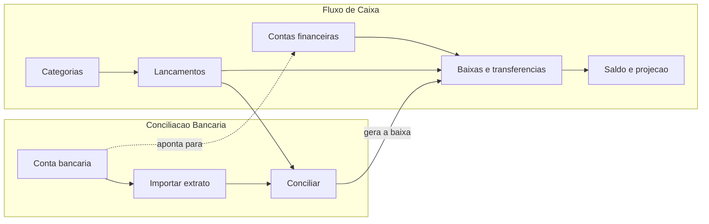

# Manual do Usuário — Índice

**Versão**: 2.1 · **Data**: 2026-10-11 · **Produto**: Agente de Bolso
**Para quem**: donos de empresa, sócios, assistentes administrativos, consultores de BPO e contadores. Não é preciso conhecer tecnologia.

**Primeira vez aqui?** Comece pelo [Guia Rápido](GUIA-RAPIDO.md): uma tabela por domínio, com o que cada funcionalidade pede, faz e entrega.

O manual é dividido por **domínio**. Escolha o que você precisa:

| Manual | Para que serve | Principais jornadas |
|---|---|---|
| **[Fluxo de Caixa](MANUAL-FLUXO-DE-CAIXA.md)** | Registrar o que vai pagar e receber, dar baixa, transferir entre contas e saber quanto tem e quanto vai ter | Categorias, contas financeiras (PJ e PF), lançamentos, baixas, transferências, saldo e projeção, corrigir erros, centros de custo e formas de pagamento, importar planilha de lançamentos, parcelar e repetir, buscar e somar |
| **[Conciliação Bancária](MANUAL-CONCILIACAO-BANCARIA.md)** | Trazer o extrato do banco, conferir o saldo e ligar cada transação ao lançamento que a explica | Conta bancária, importar extrato (OFX ou planilha), conciliar, trabalho em equipe, desfazer, BPO e auditoria, duplicidade entre origens, desfazer importação, conexão com o banco (simulada), revisão pelo banco, buscar e somar |

Visão técnica, para quem integra ou mantém o produto: [Jornada Técnica](../jornadas/JORNADA-TECNICA.md).

## Como os dois se encaixam

Texto equivalente: no fluxo de caixa você registra lançamentos e dá baixa neles; na conciliação você importa o extrato do banco, e cada transação é ligada a um lançamento. Ao ligar, a conciliação gera a baixa do lançamento no fluxo de caixa. A conta bancária aponta para uma conta financeira.

Para começar, uma ordem simples:
1. **Fluxo de caixa**: confira as categorias, cadastre as contas financeiras (dizendo se são da empresa ou pessoais) e, se usar, os centros de custo e as formas de pagamento.
2. **Conciliação**: cadastre a conta bancária.
3. **Fluxo de caixa**: registre o que você espera pagar e receber.
4. **Conciliação**: importe o extrato e concilie.

## O que está disponível

Cada jornada, nos dois manuais, traz um selo:

| Selo | Significado |
|---|---|
| **[Disponível]** | Já funciona hoje |
| **[Em construção]** | Aprovado e em desenvolvimento (nenhuma jornada dos dois manuais está nesse estado hoje) |
| **[Banco simulado]** | Funciona contra um banco de teste; a conexão real entra na Fase B |

**Dois limites desta fase**: os dados ficam **em memória** e somem quando o serviço reinicia, e o produto **ainda não passou por teste de intrusão**. Nada chega a um cliente real antes do banco de dados e desse teste. A situação de cada etapa está no [acompanhamento do projeto](ACOMPANHAMENTO-DO-PROJETO.md), e a lista de funcionalidades em [Funcionalidades](FUNCIONALIDADES.md).

Hoje o produto é um **serviço** que será usado por canais (primeiro uma interface, depois WhatsApp). Os manuais descrevem **o que você faz e o que acontece**, na linguagem do dia a dia.

## O que vale para tudo

### Quem faz o quê

| Papel | Quem é | O que pode |
|---|---|---|
| **Admin** | Sócio ou responsável financeiro | Tudo: cadastrar, lançar, importar, confirmar, desfazer |
| **Operador** | Assistente administrativo | Importar extratos e preparar propostas para o Admin aprovar |
| **Consultor BPO** | Escritório que atende várias empresas | Só consultar, nas empresas vinculadas |
| **Auditor** | Contador ou compliance | Só consultar; pode baixar o extrato original |

Se você trabalha sozinho, você é o Admin e faz tudo.

### Confirmar que é você (autenticação forte)
Ações críticas pedem um segundo fator (por exemplo, um código no celular) feito **nos últimos 15 minutos**. O produto avisa quando for preciso ("autenticação forte necessária") e você refaz a confirmação.

### Cada empresa vê só o seu
Você só vê dados da sua empresa. Se tentar abrir algo de outra empresa, o produto responde "não encontrado".

### Nada é apagado
Erro se corrige com **cancelamento ou estorno**: um novo registro que desfaz o efeito do anterior. O original fica no histórico, com quem fez, quando e por quê.

### Sua privacidade
O número completo da agência e da conta bancária nunca é guardado; o produto guarda só um código para reconhecer a conta e os 4 últimos dígitos. CPF e CNPJ aparecem mascarados. **Contas pessoais (PF)** do sócio, por padrão, só o Admin vê; os demais veem "conta restrita". A busca por CPF ou CNPJ tem limite e fica registrada.

## Outros documentos

- [Regras de negócio](../sdd/REGRAS-DE-NEGOCIO.md) e [decisões do projeto](DECISOES-DO-PROJETO.md)
- [README do produto](../../README.md)
