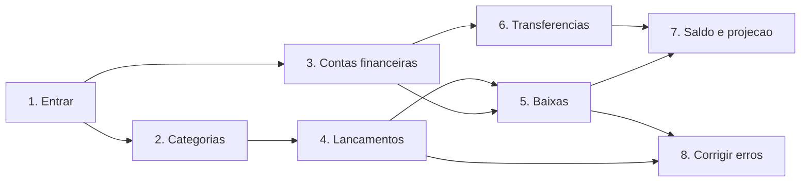
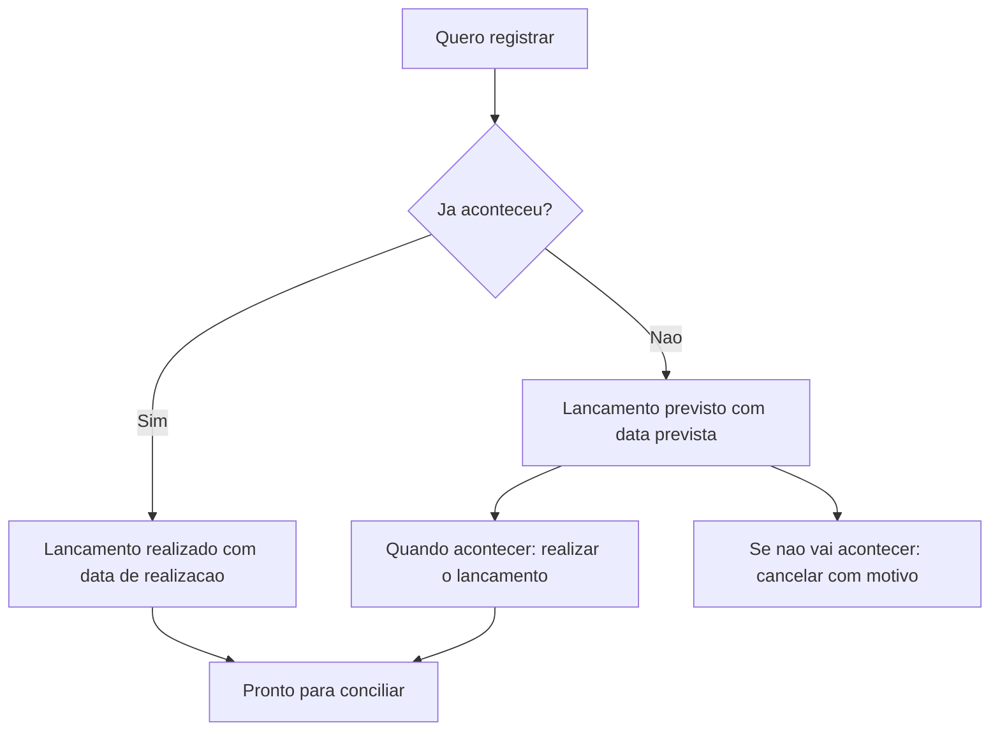
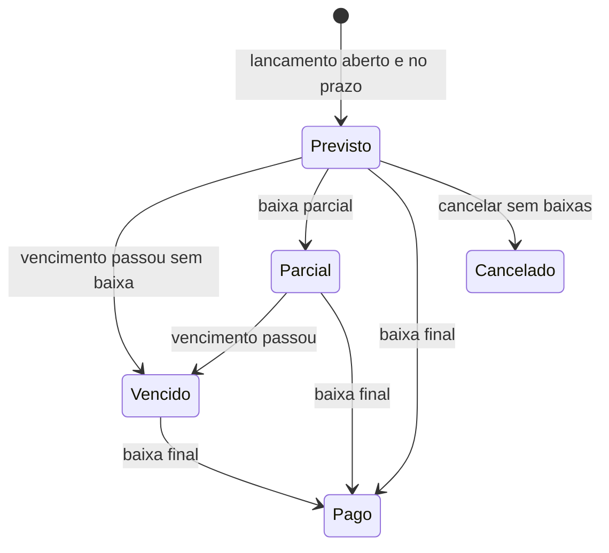
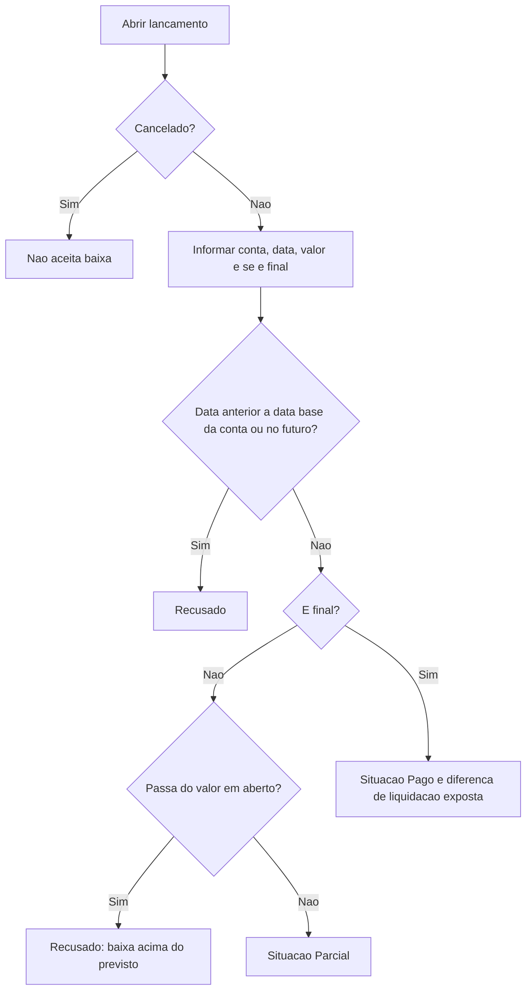
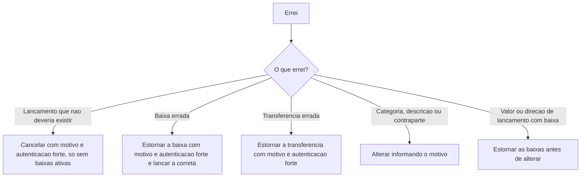
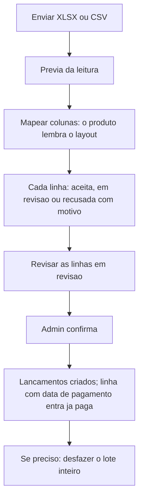

# Manual do Usuário — Fluxo de Caixa

**Versão**: 2.0 · **Data**: 2026-10-11 · **Produto**: Agente de Bolso
**Para quem**: donos de empresa, sócios e responsáveis financeiros que registram o que vão pagar e receber e querem saber quanto têm e quanto vão ter. Não é preciso conhecer tecnologia.
**Manual irmão**: [Conciliação Bancária](MANUAL-CONCILIACAO-BANCARIA.md) (importar o extrato do banco e conferir com o que foi lançado). Quem é quem e a autenticação forte estão no [índice dos manuais](MANUAL-DO-USUARIO.md).

## O que o fluxo de caixa faz

Guarda **o que você vai pagar e receber** e **o que já pagou e recebeu**, separa o que é da empresa por categoria e mostra o **saldo** de cada conta e a **projeção** dos próximos dias, com o que está atrasado em destaque.

Cada jornada traz um selo:

| Selo | Significado |
|---|---|
| **[Disponível]** | Já funciona hoje |
| **[Em construção]** | Aprovado e em desenvolvimento (nenhuma jornada deste manual está nesse estado hoje) |

| Jornada | Situação |
|---|---|
| 1. Entrar e começar | Disponível |
| 2. Organizar categorias | Disponível |
| 3. Cadastrar contas financeiras | Disponível |
| 4. Registrar o que vou pagar ou receber | Disponível |
| 5. Dar baixa: pagar ou receber, no todo ou em partes | Disponível |
| 6. Transferir entre minhas contas | Disponível |
| 7. Saber quanto tenho e quanto vou ter | Disponível |
| 8. Corrigir um erro | Disponível (cancelar e estornar) |
| 9. Consultar e acompanhar | Disponível para consulta |
| 10. Centros de custo e formas de pagamento | Disponível |
| 11. Contas da empresa e contas pessoais (PJ e PF) | Disponível |
| 12. Importar contas a pagar e a receber de uma planilha | Disponível |
| 13. Parcelar e repetir | Disponível |
| 14. Buscar e somar o que foi selecionado | Disponível |

> **Fase atual**: os dados ficam **em memória** e somem quando o serviço reinicia. O banco de dados entra na Fase B, antes de qualquer cliente real.

Texto equivalente: você entra, organiza as categorias e cadastra as contas; registra os lançamentos e dá baixa neles; transfere entre contas; o saldo e a projeção saem disso; e qualquer erro se corrige com cancelamento ou estorno, nunca apagando.

---

## Jornada 1 — Entrar e começar **[Disponível]**

1. Entre pelo canal da sua empresa. Seu acesso já traz a empresa e o seu papel.
2. Na primeira vez, o produto prepara o **plano de contas** da empresa (Jornada 2). Você não precisa pedir.
3. Tudo o que você vê é só da sua empresa. Se tentar abrir algo de outra empresa, o produto responde "não encontrado".

Quem pode alterar: o **Admin**. Operador, Consultor BPO e Auditor só consultam.

---

## Jornada 2 — Organizar categorias **[Disponível]**

1. A empresa já começa com **20 categorias** prontas para prestadores de serviço (receitas, custos, despesas, resultado financeiro etc.).
2. O Admin pode **criar** uma categoria (nome de 2 a 60 caracteres e a direção, entrada ou saída), **renomear** as que criou, **desativar** e **reativar**.
3. Categorias **não são excluídas**. Desativar uma categoria **não mexe** nos lançamentos que já a usam; só impede novos usos.
4. As categorias de sistema (tarifas bancárias, receitas financeiras, transferência interna, estornos) não podem ser renomeadas nem desativadas.

Uma categoria de saída não aceita lançamento de entrada, e vice-versa.

**Disponível**: cada categoria tem a **natureza na DRE** (receita bruta, deduções, custo do serviço, despesa operacional, resultado financeiro, imposto sobre o lucro, não operacional ou neutra) e a **atividade na DFC** (operacional, investimento ou financiamento), com até 2 níveis (por exemplo, "Despesas operacionais" e, dentro dela, "Viagens a clientes"). Impostos sobre faturamento (ISS, Simples, PIS e COFINS) ficam como **dedução da receita**, não como custo do serviço. O plano inicial será revisado por um contador antes da entrega.

---

## Jornada 3 — Cadastrar contas financeiras **[Disponível]**

**Quem faz**: Admin, com autenticação forte.

1. Cadastre cada conta onde o dinheiro da empresa fica: **bancária**, **caixa** (dinheiro físico) ou **carteira digital**. Cartão de crédito ainda não é suportado.
2. Informe o **nome**, o **saldo inicial** e a **data base** (a partir de quando o saldo do sistema vale). Cadastre o saldo de hoje. Ele pode ser **negativo**, como no cheque especial.
3. A conta aparece na lista e passa a aceitar baixas e transferências **a partir da data base**. Antes dela, o produto recusa.
4. Para parar de usar uma conta, **inative-a**: ela some das escolhas, o histórico fica e nada é excluído.

Dois nomes iguais não são aceitos.

---

## Jornada 4 — Registrar o que vou pagar ou receber **[Disponível]**

**Quem faz**: Admin.

1. Informe **valor**, **direção** (entrada ou saída), **descrição**, **categoria** e a data.
2. O valor tem no máximo duas casas decimais e é sempre positivo; a direção diz se entrou ou saiu. Valor zero não é aceito.
3. Para um **previsto**, informe a data prevista. Para um **realizado**, a data em que aconteceu (não pode ser no futuro).
4. Opcional: **centro de custo** e **forma de pagamento** (Jornada 10), **contraparte** (quem paga ou recebe) e um **identificador de cobrança** (por exemplo, o código do boleto ou do Pix). Esse identificador ajuda a conciliação a achar o lançamento sozinha e **não pode se repetir** entre lançamentos não cancelados.
5. Quando o dinheiro de um previsto se mover, **realize** o lançamento informando a data.
6. **Cancelar**: Admin, com autenticação forte, **motivo de pelo menos 10 caracteres**, e só se o lançamento não estiver conciliado. Nada é apagado.

**Atenção**
- Lançamento **conciliado** é protegido: valor, direção e datas não mudam. Para corrigir, desfaça o vínculo antes (veja o [manual de conciliação](MANUAL-CONCILIACAO-BANCARIA.md)). Categoria, descrição e contraparte ainda podem mudar.
- Se duas pessoas editam o mesmo lançamento ao mesmo tempo, a segunda recebe "conflito de versão": recarregue e tente de novo.

**O lançamento completo**

| Novidade | Como vai funcionar |
|---|---|
| **Três datas** | **Vencimento** (quando deveria pagar ou receber), **competência** (a que mês econômico pertence, alimenta a DRE) e **liquidação** (quando o dinheiro se moveu, alimenta o fluxo realizado) |
| **Campos obrigatórios** | Descrição, vencimento, competência e categoria. A conta onde vai liquidar é opcional agora e obrigatória na baixa |
| **Situação automática** | Cada lançamento aparece como **Previsto**, **Parcial**, **Pago**, **Vencido** ou **Cancelado**, calculado na hora. Você não digita a situação, e o produto não aceita que ela seja enviada |
| **Motivo nas alterações** | Toda alteração pede um motivo e fica no histórico, com quem alterou e quando |
| **Histórico do lançamento** | Admin, Consultor BPO e Auditor consultam quem alterou o quê, quando e por quê |

### As cinco situações

O estado é **calculado a cada consulta**; nenhuma rotina noturna o atualiza. Estornar uma baixa faz o lançamento voltar à situação que as baixas restantes e a data de vencimento indicam.

---

## Jornada 5 — Dar baixa: pagar ou receber, no todo ou em partes **[Disponível]**

**Quem faz**: Admin.

1. Abra o lançamento e escolha **registrar baixa**.
2. Informe a **conta**, a **data** em que o dinheiro se moveu (não pode ser futura), o **valor** e se é a baixa **final**.
3. **Baixa parcial**: pagou R$ 400,00 de R$ 1.000,00? Registre R$ 400,00 sem marcar como final. O lançamento fica **Parcial**, com R$ 600,00 em aberto, e aceita novas baixas. Uma baixa parcial não pode passar do que falta.
4. **Baixa final**: encerra o lançamento. Se o valor pago difere do previsto, a **diferença** aparece, nunca some no valor:

| Caso | Aparece como |
|---|---|
| Conta a pagar de R$ 1.000,00, paga R$ 1.050,00 | R$ 50,00 de **juros e multa pagos** |
| Conta a pagar de R$ 1.000,00, paga R$ 970,00 | R$ 30,00 de **desconto obtido** |
| Conta a receber de R$ 1.000,00, recebe R$ 1.020,00 | R$ 20,00 de **juros e multa recebidos** |
| Conta a receber de R$ 1.000,00, recebe R$ 950,00 | R$ 50,00 de **desconto concedido** |

5. Opcional: a **referência do comprovante**.
6. O saldo da conta muda a partir da data da baixa.

**Regras importantes**
- Uma baixa **confirmada não se edita**. Para corrigir, **estorne** e lance a correta (Jornada 8).
- Baixas criadas pela **conciliação** (quando o extrato é cruzado com o lançamento) aparecem aqui com a origem "conciliação" e **só se estornam desfazendo o vínculo** na conciliação.
- Reenviar a mesma baixa por engano (um clique duplo, uma conexão que caiu) **não duplica**: o produto reconhece a repetição.

---

## Jornada 6 — Transferir entre minhas contas **[Disponível]**

**Quem faz**: Admin.

1. Informe a **conta de origem**, a **conta de destino**, a **data** e o **valor**. Origem e destino têm de ser diferentes.
2. O saldo de cada conta muda a partir da data. **Receitas e despesas da empresa não mudam**: transferência não é receita nem despesa, não entra na DRE nem na DFC.
3. Para desfazer, **estorne** a transferência, com motivo e autenticação forte. O original fica no histórico.

---

## Jornada 7 — Saber quanto tenho e quanto vou ter **[Disponível]**

| Pergunta | Resposta do produto |
|---|---|
| **Quanto tenho na conta X em tal data?** | **Saldo realizado** = saldo inicial + entradas pagas − saídas pagas ± transferências, até a data. Estornos e lançamentos sem baixa não entram. Antes da data base, o produto recusa |
| **Quanto tenho no total?** | O saldo de cada conta ativa, somados na projeção |
| **Quanto vou ter nos próximos 30 dias?** | **Projeção de caixa**, em cinco blocos separados |

### A projeção de caixa

| Bloco | O que mostra |
|---|---|
| 1. Saldo realizado de hoje | Soma das contas ativas |
| 2. Entradas previstas | A receber com vencimento entre hoje e o fim do horizonte |
| 3. Saídas previstas | A pagar com vencimento no mesmo período |
| 4. **Entradas vencidas e não recebidas** | Em destaque, **separadas** das previstas |
| 5. **Saídas vencidas e não pagas** | Em destaque, **separadas** das previstas |

Só entra o valor que **falta** pagar ou receber (lançamento com baixa parcial entra só pelo que sobra). Cancelados não entram. O atrasado aparece à parte para você **não se enganar com um caixa otimista**.

Exemplo: uma entrada de R$ 2.000,00 vencida há 10 dias aparece no bloco 4, nunca no bloco 2.

---

## Jornada 8 — Corrigir um erro **[Parcialmente disponível]**

**Regra de ouro: nada é apagado.** Correção é sempre um **novo registro** (cancelamento ou estorno) que desfaz o efeito do anterior; o original continua no histórico.

| O que corrigir | Como | Situação |
|---|---|---|
| Lançamento criado por engano | **Cancelar**, com motivo de 10+ caracteres e autenticação forte. Só se não estiver conciliado (hoje) e **sem baixas ativas** (com a baixa, estorne-as antes) | Disponível |
| Categoria, descrição, contraparte | Alterar. Toda alteração registra o autor e, quando há baixa, pede o motivo | Disponível |
| Baixa lançada errada | **Estornar a baixa** (motivo de 10+ caracteres, autenticação forte) e lançar a correta. A diferença de liquidação que ela gerou também some | Disponível |
| Transferência errada | Estornar, com motivo e autenticação forte | Disponível |
| Valor ou direção de um lançamento com baixa | Não podem mudar. Estorne as baixas, altere, e dê baixa de novo | Disponível |

---

## Jornada 9 — Consultar e acompanhar **[Disponível para consulta]**

- **Todos os papéis** consultam lançamentos, categorias, contas, saldos e projeção. Listagens podem ser filtradas por situação, direção, categoria, conta, centro de custo, forma de pagamento e período, e aceitam um **texto de busca** (Jornada 14).
- **Consultor BPO**: com um acesso, consulta as empresas clientes a que foi vinculado. **Só lê**; cada leitura fica registrada.
- **Auditor**: consulta tudo em modo leitura, com registro de acesso, e pode **verificar a integridade da trilha**: o produto recalcula os selos de todas as ações e diz se está íntegra ou aponta o primeiro registro alterado.
- **Histórico de um lançamento**: cada alteração com autor, data, valores anterior e novo e o motivo.

---

## Jornada 10 — Centros de custo e formas de pagamento **[Disponível]**

**Quem faz**: Admin. Os demais papéis consultam.

1. **Centro de custo** diz para quem ou onde o gasto aconteceu (por exemplo, "Projeto Alfa", "Loja Centro"). **Forma de pagamento** diz como foi pago (Pix, boleto, cartão, dinheiro).
2. Crie, renomeie, **inative** e **reative**. Nada é excluído; inativar só impede usos novos, e os lançamentos antigos continuam com o que tinham.
3. O nome é único na empresa, sem diferenciar maiúsculas e acentos ("Logística" e "logistica" são o mesmo). Máximo de **100 ativos** de cada.
4. Os dois são **opcionais** no lançamento e servem para filtrar, buscar e, mais tarde, para os relatórios.

---

## Jornada 11 — Contas da empresa e contas pessoais (PJ e PF) **[Disponível]**

Toda conta financeira tem **titularidade**: **PJ** (da empresa) ou **PF** (pessoal do sócio). Muita empresa pequena paga uma conta da empresa pela conta pessoal do sócio; o produto registra isso **sem misturar** os números.

| Regra | O que acontece |
|---|---|
| **Saldo e projeção** | Por padrão somam **só contas PJ**. A parte PF aparece **separada e declarada**, só para quem pode ver |
| **Quem vê contas PF** | Por padrão, **só o Admin**. Para os demais, a conta aparece como "conta restrita"; o lançamento pago por ela continua visível e somado, sem mostrar qual conta foi |
| **Transferência entre PJ e PF** | **Recusada**. Dinheiro entre a empresa e o sócio não é transferência interna: é retirada, aporte ou empréstimo, e precisa ser lançado como tal |
| **Corrigir a titularidade** | Só em conta **sem movimento**, pelo Admin, com autenticação forte e motivo |

---

## Jornada 12 — Importar contas a pagar e a receber de uma planilha **[Disponível]**

**Quem faz**: Admin ou Operador enviam, mapeiam e revisam. **Só o Admin confirma.** No modo estrito, quem preparou o lote não confirma: outro Admin confirma.

Texto equivalente: você envia a planilha, vê a prévia, diz qual coluna é qual (o produto lembra da próxima vez), revisa as linhas com dúvida e o Admin confirma. Se algo saiu errado, desfaz o lote inteiro.

1. **Envie** a planilha (XLSX ou CSV). O produto lê pelo conteúdo, **nunca calcula fórmula** e recusa macro, PDF e imagem. Limites: 10 MB, 5.000 linhas, 50 colunas.
2. **Mapeie** as colunas (descrição, valor, vencimento, categoria, conta, competência, data de pagamento etc.). O **layout** fica lembrado para a próxima planilha igual.
3. **Categoria e conta pelo nome**: o produto procura pelo nome e lembra a correspondência que você escolheu. **Nunca cria cadastro sozinho**.
4. **Valores**: aceitos em `1.234,56` ou `1234.56`. Mais de 2 casas decimais é **recusado**, nunca arredondado.
5. **Competência**: pela coluna, se houver; senão, pelo mês informado para o lote.
6. **Linha com data de pagamento** entra como **já paga**: o lançamento e a baixa são criados juntos.
7. **Já pago em conta pessoal (PF)**: a linha vai para revisão, e você escolhe uma conta da empresa, trata como previsto ou recusa.
8. **Recebido menor que a nota** (pagamento parcial, desconto ou imposto retido): a linha vai para revisão com aviso. Para imposto retido, o produto só avisa, até o contador definir a regra.
9. **Confirmar**: o Admin grava item a item. Se o fluxo de caixa recusar algum item, ele volta para a revisão com o motivo; depois o Admin **reprocessa só os recusados**, sem duplicar.
10. **Enviar o mesmo arquivo de novo** não duplica: o produto devolve o lote que já existe.

**Desfazer o lote**: Admin, com autenticação forte, prévia, motivo e segregação. Cancela os lançamentos e estorna as baixas do lote, **tudo ou nada**. Se alguma baixa já foi conciliada com o extrato, o desfazer é bloqueado: desfaça a conciliação antes.

---

## Jornada 13 — Parcelar e repetir **[Disponível]**

**Quem faz**: Admin cria, edita e estende. Todos consultam.

| Quero | Como funciona |
|---|---|
| **Parcelar** uma compra ou venda | Informe o **valor total** e o número de parcelas, **de 2 a 60**, todo mês no mesmo dia. Cada parcela é um lançamento. O **centavo que sobra** da divisão vai na **última** parcela. Todas ficam na **competência da operação** (a compra parcelada é do mês da compra) |
| **Repetir** todo mês (aluguel, mensalidade) | Informe o **valor de cada mês** e quantos meses, **de 2 a 60**. A competência anda **mês a mês**. Dá para **estender** depois |
| **Ver antes de gravar** | Peça a **prévia**: o produto mostra todas as parcelas, sem gravar nada |
| **Mudar uma parcela** | "**Só esta**": altere o lançamento como qualquer outro |
| **Mudar daqui para frente** | "**Esta e as próximas**": parcelas **com baixa ou canceladas ficam de fora**; nada é redistribuído entre as parcelas |
| **Encerrar** a série | Cancelar "esta e as próximas": Admin com **autenticação forte**, prévia, motivo e segregação (no modo estrito, outro Admin confirma). As parcelas já baixadas continuam; nada é apagado |

Dia 31 em mês curto cai no último dia do mês. O histórico da série mostra cada criação, edição, extensão e encerramento.

---

## Jornada 14 — Buscar e somar o que foi selecionado **[Disponível]**

**Quem faz**: todos os papéis.

**Buscar.** Escreva no campo de busca da listagem de lançamentos (ou de transações do banco, no [manual de conciliação](MANUAL-CONCILIACAO-BANCARIA.md)). A busca vale junto com os filtros.

| Você escreve | O produto procura |
|---|---|
| Palavras (`aluguel sala`) | Pedaços da descrição, da contraparte, da categoria e da conta, **sem diferenciar acentos e maiúsculas**. Todas as palavras precisam aparecer |
| Valor escrito como dinheiro (`1.250,50`, `R$ 12`, `12,00`) | O valor exato. Um número solto como `12` é tratado como **palavra**, não como valor, para não confundir com "Nota 12" |
| CPF ou CNPJ, com ou sem pontuação | O documento **exato** da contraparte, inclusive o **CNPJ novo, com letras** (por exemplo, `12.ABC.345/01DE-35`). Na resposta, o documento aparece **mascarado** |
| Código de cobrança | O identificador exato |

O texto vai de 1 a 100 caracteres. Para evitar que alguém use a busca para descobrir quem são os seus clientes e fornecedores, a busca tem **limite por pessoa**; a busca por CPF ou CNPJ tem um limite menor e **fica registrada na auditoria**, sem guardar o documento procurado.

**Somar a seleção.** Marque itens em várias páginas (até 1.000) **ou** peça a soma de **tudo o que o filtro e a busca trouxeram**. O produto devolve:

| Total | O que é |
|---|---|
| **Previsto** | Entradas, saídas e líquido do que foi lançado |
| **Pago** | O que já teve baixa |
| **Em aberto** | O que falta pagar ou receber |
| **Fora da soma** | Cancelados, contados à parte |
| **Não encontrados** | Itens marcados que não existem ou que você não pode ver |
| **Dos quais em contas pessoais** | A parte paga por conta PF, **só para quem pode ver** contas PF |

A soma é exata, em centavos.

---

## Perguntas frequentes

**Posso apagar um lançamento?** Não. Você cancela (se não tem baixa) ou estorna as baixas e depois cancela. O histórico fica.

**O lançamento ficou "Vencido" sozinho?** Sim: a situação é calculada na hora pela data de vencimento. Dar a baixa o tira dessa situação.

**Paguei um pouco a mais (juros). Onde isso aparece?** Como diferença de liquidação, na categoria de resultado financeiro. Não altera o valor do lançamento.

**Por que não posso mudar o valor de um lançamento que já foi pago em parte?** Para o histórico financeiro continuar idôneo. Estorne as baixas, corrija e dê baixa de novo.

**Transferir para minha conta pessoal conta como despesa?** Não. Transferência entre contas próprias só muda o saldo de cada conta.

**Paguei uma conta da empresa pela conta do sócio. Como registro?** Lance normalmente e dê baixa pela conta PF. O pagamento entra nos números da empresa; a conta pessoal só aparece para quem pode ver contas PF.

**Parcelei R$ 100,00 em 3 vezes. Como ficam os centavos?** R$ 33,33, R$ 33,33 e R$ 33,34: o centavo que sobra vai na última parcela.

**Busquei "12" e não achei o lançamento de R$ 12,00.** Um número solto é tratado como palavra. Escreva como dinheiro: `12,00` ou `R$ 12`.

**Quando o plano de contas inicial estará revisado?** Antes da entrega do fluxo de caixa completo, por um contador.

---

## Onde saber mais

- [Manual de Conciliação Bancária](MANUAL-CONCILIACAO-BANCARIA.md)
- [Índice dos manuais](MANUAL-DO-USUARIO.md)
- [Regras de negócio](../sdd/REGRAS-DE-NEGOCIO.md) · [Jornada técnica](../jornadas/JORNADA-TECNICA.md)
